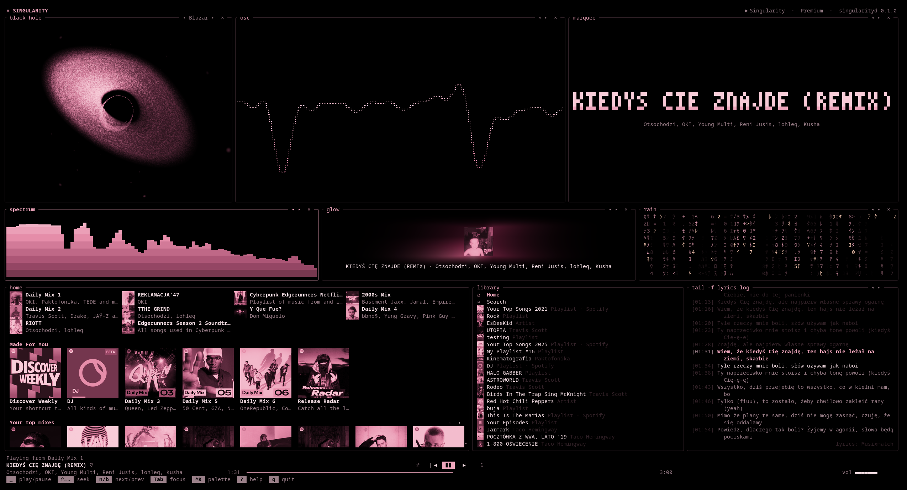
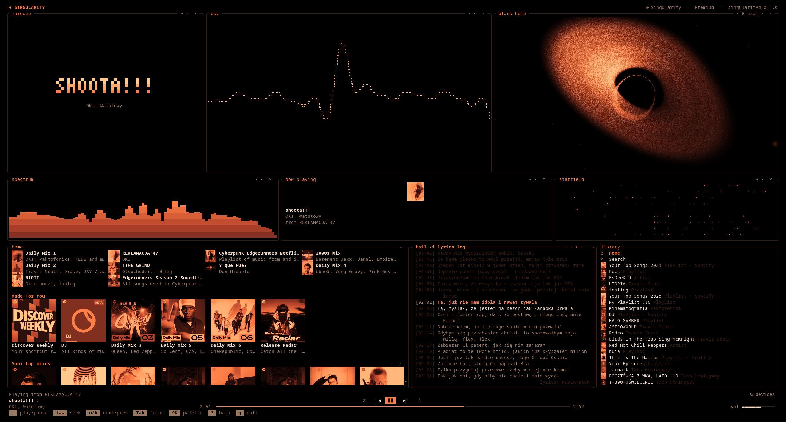
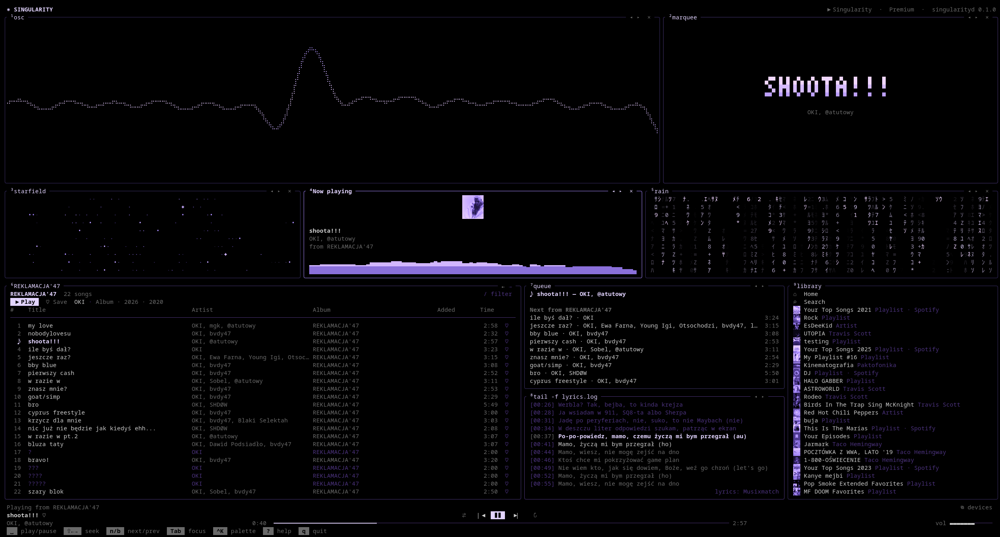
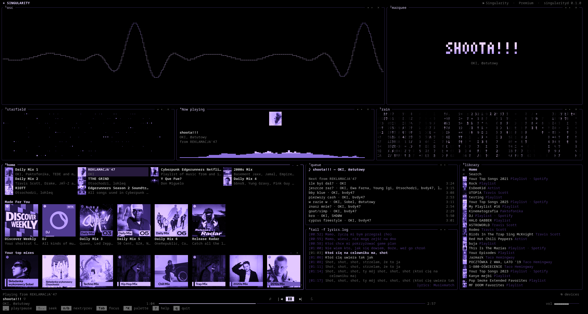
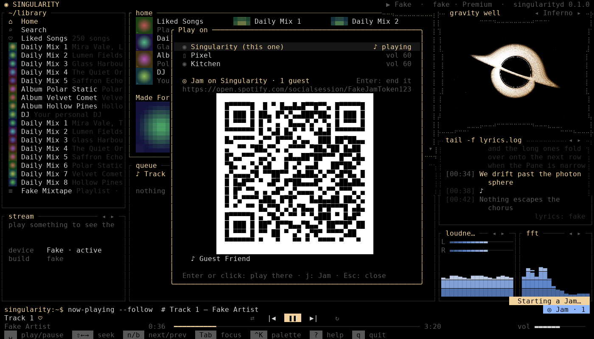

# Singularity

A Spotify TUI client for Linux and macOS that keeps nearly everything the desktop app does, plays lossless audio
and puts the visuals first. Keyboard and mouse driven, with built-in themes and audio-reactive visuals (yes, including
a black hole), modular and customisable.



| Ember | An album | Queue and lyrics |
|---|---|---|
|  |  |  |

The Jam picker: the invite link, its QR code and a guest (from the test harness, made-up account).



**Status:** `v0.1.0`. **Linux** is the supported platform; **macOS is a beta**: everything is there, but some of it
hasn't been checked by hand on a Mac yet (see the issues). Spec in `docs/SPEC.md`.

Linux and macOS have the same features (the rule is D49); `docs/PLATFORMS.md` lists every feature's exact status on
each, and the few real differences.

## Not affiliated with Spotify

Singularity is an independent project. It is **not affiliated with, endorsed by or connected to Spotify**. It needs
a **Spotify Premium** account, and it talks to Spotify through **private, undocumented APIs**, the ones Spotify's own
apps use. That is against Spotify's Terms of Use, and Spotify may change those APIs, and break Singularity, at any
time. Spotify could also restrict or close an account that uses them. **Use it with your own account, at your own
risk.** Singularity never sees your password (you log in on spotify.com) and plays only what your account may play.

## Build and run

Two programs: `singularityd`, the Daemon (it plays the music and keeps playing when you close the terminal), and
`singularity`, the Client (the TUI; open as many as you like). The Client starts the Daemon by itself.

### Linux

Needs: Rust 1.89 or newer (stable, via rustup), a C toolchain, `pkg-config`, the OpenSSL and ALSA development files, PipeWire (or
PulseAudio) with `pactl`/`parec`, and a Secret Service keyring (`secret-tool`: GNOME Keyring, KWallet, KeePassXC).
Arch: `pacman -S rustup base-devel pkgconf openssl alsa-lib libpulse libsecret`; Debian/Ubuntu:
`apt install build-essential pkg-config libssl-dev libasound2-dev pulseaudio-utils libsecret-tools`.

```sh
cargo install --locked --path crates/daemon
cargo install --locked --path crates/client
singularity                         # ~/.cargo/bin on your PATH
```

(For a quick try without installing: `cargo build --release && ./target/release/singularity`.)

First run: the setup wizard asks for a **Soloist API key** (free, from https://developer.spotify.com/dashboard/soloist
with your Premium account; it goes to the keyring), downloads Soloist from Spotify, and asks you to pick
"Singularity" once in your phone's Spotify device picker (same network). Then "Log in to Spotify" (approve a code in
the browser) for Home, the library and search, and an audio check. Lossless: on the phone, device picker →
Singularity → Change quality settings → Lossless (once).

On a PC shared with other people: Soloist takes its key only on its command line, so other local users can see it
with `ps`. Mounting `/proc` with `hidepid=invisible` hides other users' processes (the health check warns about it too).

Start at login (optional): `cp packaging/systemd/singularityd.service ~/.config/systemd/user/ && systemctl --user
enable --now singularityd`.

### macOS (beta)

Needs macOS 14.2 or later (15 tested, on an M2 Air), Apple's Command Line Tools (`xcode-select --install`), and Rust:
`brew install rustup && rustup default stable` (Homebrew's rustup is keg-only: put
`/opt/homebrew/opt/rustup/bin` and `~/.cargo/bin` on your PATH, e.g. in `~/.zshrc`).

```sh
cargo install --locked --path crates/daemon
cargo install --locked --path crates/client
singularity
```

First run: "Log in to Spotify" (approve a code in the browser). That's all for the default player, librespot: it
plays as your account from inside the Daemon. For lossless, see "Choosing the player" below.

Start at login (optional): `packaging/launchd/install.sh` (a LaunchAgent; `--uninstall` removes it).

### Choosing the player

`[engine] kind` in `~/.config/singularity/config.toml` (or Ctrl+K → Settings → `engine.kind`); restart Singularity
(quit with `q`, start again) after changing it.

| `kind` | Linux | macOS | Lossless | Cost while playing |
|--------|-------|-------|----------|--------------------|
| `auto` (default) | = `soloist` | = `librespot` | Linux yes, macOS no | |
| `soloist` | Spotify's Soloist, headless | Soloist in a small Linux VM that Singularity runs for you | yes | macOS: ~300 MB, idle ~1 % CPU |
| `librespot` | built into the Daemon | built into the Daemon | no (320 kbps at most) | ~28 MB, ~1 % CPU |
| `spotify-app` | the official app, hidden, driven over Connect | the same | yes (the app's own setting) | ~600 MB, 5–25 % CPU |

All of them show up in Spotify's device pickers and are driven the same way; the audio Widgets work with every one
(with the app on macOS, after granting a permission: see below).

### macOS quirks (what's different from Linux, and why)

- **The default plays at most 320 kbps.** Soloist, Spotify's own headless lossless player, is Linux-only, so on a Mac
  the default is librespot (light, no setup), and lossless means `kind = "soloist"` (the VM) or `"spotify-app"`.
- **`kind = "soloist"` runs a Linux VM** (Apple's Virtualization framework, through `vfkit`; networking through
  `gvproxy`). The first start downloads ~250 MB (the two helpers, pinned by checksum, and Debian's arm64 cloud
  image) and sets the VM up in about two minutes; after that it starts in ~6 s. It lives in
  `~/.local/share/singularity/vm/` (~1.5–2 GB on disk) and uses ~300 MB of memory while it runs. It needs a Soloist
  API key (the wizard asks; or `security add-generic-password -U -s singularity -a soloist -w`) and **one pairing
  from your phone on the same Wi-Fi**: pick "Singularity on <your Mac> (lossless)" in the device picker, and set it
  to Lossless there. A quality change applies from the next track.
  - With a VPN on (Mullvad and similar), allow local network sharing, or the phone can't reach the Mac to pair.
  - macOS's firewall silently blocks programs it doesn't trust from accepting connections, Singularity included, so
    while pairing (only then) a tiny relay runs in Apple's own `python3`.
  - Pairing can't be done without the phone: Soloist only accepts a login minted for it by Spotify's apps.
- **`kind = "spotify-app"`** needs Spotify.app installed and logged in to the same account; Singularity starts it
  hidden and leaves it running. For the audio Widgets macOS must let your terminal record other apps' audio: System
  Settings → Privacy & Security → Screen & System Audio Recording → **System Audio Recording Only** → add your
  terminal app. Without it the Widgets stay flat and Singularity says so once.
- **Audiobooks don't play on the default.** Spotify won't give librespot the keys to audiobook chapters, so books
  play with `kind = "soloist"` (the VM) or `"spotify-app"`; with librespot their pages, library rows and search
  still work, and pressing play says so. (Same on Linux with librespot; Linux's default, Soloist, plays them.)
- **Media keys and Control Centre**: with librespot or the VM, Singularity has its own Now Playing entry (play,
  pause, next, previous, drag the position); with the app, the app's own entry. There's no MPRIS (that's D-Bus,
  Linux's).
- **Track notifications** (`[notifications] track_change`) appear through `osascript`, so macOS shows them as Script
  Editor's, without the cover.
- **Secrets** go to the login Keychain through `/usr/bin/security` (so rebuilt binaries read them without a prompt).
- The Daemon's socket is under `$TMPDIR` (no `$XDG_RUNTIME_DIR` on macOS); config and data use the same
  `~/.config/singularity` and `~/.local/share/singularity` paths as Linux.
- The stream Pane's download speed and stall count come from Soloist's log on Linux; the other players don't report
  them.

## Using it

- Ctrl+K → "Health check" shows what's working (player, login, network, audio output, stream quality).
- **Browsing**: Ctrl+K → "Log in to Spotify" (approve the code at spotify.com/pair). Home, the library sidebar and
  track lists appear once logged in.
- **Jam**: `d` opens the device picker; its last row starts a Jam on this device (`j` there too). Friends scan the QR
  or open the link to add songs and skip; Enter on the row twice ends it, and the music keeps playing. Hosting needs
  Premium.
- Keys worth knowing: Space play/pause, Shift+←/→ seek, Ctrl+K palette, Ctrl+L search, `d` devices, `v` swaps the focused Pane's Widget (on the black hole: its Disk look),
  Alt+←/→ back/forward, `l` like, `?` help. Everything is clickable too. `q` (or Esc) quits the Client; the music
  keeps playing.
- **Settings**: Ctrl+K → "Settings", or `~/.config/singularity/config.toml` and `keys.toml` (written with comments on
  first start; saves apply at once). `preset = "vim"` in keys.toml adds h/j/k/l movement.
- **Designs**: Ctrl+K → "Pick a design" (Singularity, Event Horizon, Classic+, Cockpit, Terminal) and "Pick a theme", both with a live
  preview; `t` cycles a design's palettes. Your own themes go in `~/.config/singularity/themes/` (see `_example.toml`).
- **Layouts**: drag the border between two Panes to resize them (it lights up under the pointer, and kitty or
  Ghostty show a resize pointer); `v` (or a Pane's ◂ ▸) swaps its Widget; Ctrl+K → "Save design as…" keeps it, and it
  comes back, colours included, in Ctrl+K → Pick a design.
- **Tiling**: drag a Pane by its title bar: onto another Pane's middle to swap, onto its edge to split it, onto the
  screen's edge (the outermost column, or past the top or bottom of the Panes) for a full-height column or
  full-width row. The Pane floats under the pointer and the others make room around where it would land once
  you pause over a spot (a quick sweep across Panes leaves them be; letting go drops where the pointer is); Esc
  cancels. A Pane too small to share with another is a swap target only. While anything moves the Client draws at
  `visuals.motion_fps` (Settings; 30–240, default 120: set it to your monitor's refresh rate). Your terminal caps it
  too: Ghostty follows the monitor; in kitty lower `repaint_delay` (and keep `sync_to_monitor`); otherwise see your
  terminal's repaint settings. `×` in a
  title closes a Pane, right-click a title to split or close, Ctrl+K has Split right / Split down / Close pane / Move
  pane / Reset design. `m` moves the focused Pane from the keyboard: arrows swap with the neighbour, ⇧arrows split
  beside it, `+` `-` size it, `x` closes it, `u` undoes, Enter or Esc ends. Ctrl+Z undoes a layout change and
  Ctrl+Y (or Ctrl+Shift+Z) redoes it; the bar offers "undo" for a few seconds after each one. Home, the library, the queue and lyrics can move but
  never close, and nothing can be dropped where a Pane would get too small. The first edit of a built-in Design asks
  what to call your Design (Esc keeps one unnamed "Singularity (edited)"); after that it saves itself.
- **Idle**: after 3 minutes without input the black hole drifts over the screen; any key wakes it (and does nothing
  else). Shift+I or `[idle]` in config.toml switches it off or changes the delay.
- **Listening log** (private, local): every track you hear for 30 s is logged in `~/.local/share/singularity/`, and
  Liked Songs and your own playlists are backed up there nightly. Cockpit's listening Pane and the Stats page show it;
  Ctrl+K → "Export listening data" / "Delete listening data". Nothing is uploaded.
- After a rebuild, the next Client notices the running Daemon is older than the installed `singularityd` and replaces
  it by itself ("Updating singularityd…"; the music pauses for a moment).
- Terminals: kitty, Ghostty and WezTerm get the pixel tier (covers, the GPU black hole); every other terminal the cell
  tier.

### For development

- `singularityd --fake-engine` runs a pretend player for UI work; `--no-catalogue` skips Spotify browsing;
  `--fake-catalogue crates/client/tests/fixtures/home.json` serves a recorded (anonymised) Home feed (a build with
  `cargo build -p singularityd --features fake`).
- `cargo test --workspace`; on a Mac, `tools/check-linux.sh` type-checks the Linux build (zig, cargo-zigbuild,
  openssl@3: see the script). The pty harness in `tools/pty/` screenshots the real binaries (its README).
- `CLAUDE.md` has the working agreements.

## Docs

| Doc | What's in it |
|-----|--------------|
| [docs/SPEC.md](docs/SPEC.md) | The spec: v1 (stories 1–67), v1.x (68–87), implementation and testing decisions, the final audit |
| [docs/DESIGN-TREE.md](docs/DESIGN-TREE.md) | Every open decision, its dependencies, and the grilling round log |
| [docs/ROADMAP.md](docs/ROADMAP.md) | Phased plan, spikes first |
| [docs/research/2026-10-platform-constraints.md](docs/research/2026-10-platform-constraints.md) | What Spotify does and doesn't allow in 2026, with sources |
| [docs/ideas/visuals-and-widgets.md](docs/ideas/visuals-and-widgets.md) | Brainstorm of visuals, widgets and layout modes |
| [docs/ideas/layout.md](docs/ideas/layout.md) | Free tiling: the idea bank it started from (built, D66) |
| [GLOSSARY.md](GLOSSARY.md) | The project's vocabulary (Engine, Catalogue, Shelf, Widget, Pane, …) |
| [docs/adr/](docs/adr/) | Hard-to-reverse decisions: Soloist Engine, private-API Catalogue, Daemon + Client, GPU visuals |
| [docs/research/2026-10-private-api-risk.md](docs/research/2026-10-private-api-risk.md) | How risky the private API is for a one-person client |
| [docs/PLATFORMS.md](docs/PLATFORMS.md) | Linux/macOS parity: every feature and platform seam, and its exact status |
| [docs/research/2026-10-macos.md](docs/research/2026-10-macos.md) | How macOS support came about (the Engine options, the audio tap) |
| [docs/research/2026-10-soloist-vm-spike.md](docs/research/2026-10-soloist-vm-spike.md) | Soloist in a Linux VM on macOS: measurements, pairing, the firewall |
| [docs/research/2026-10-free-tiling.md](docs/research/2026-10-free-tiling.md) | What fully free tiling would take |

The early spikes (`spikes/`) and design prototypes (`prototypes/`) are in the git history, before the first public
release.

## Process

Planning follows Matt Pocock's [skills](https://github.com/mattpocock/skills):
`grill-with-docs` (interview in rounds over a design tree, write glossary + ADRs as we go), then
`to-spec`, then tickets, then implementation. The grilling skills are vendored in `.claude/skills/`,
so `/grill-with-docs` works in any Claude Code session opened here.

## Licence

MIT: see [LICENSE](LICENSE).
