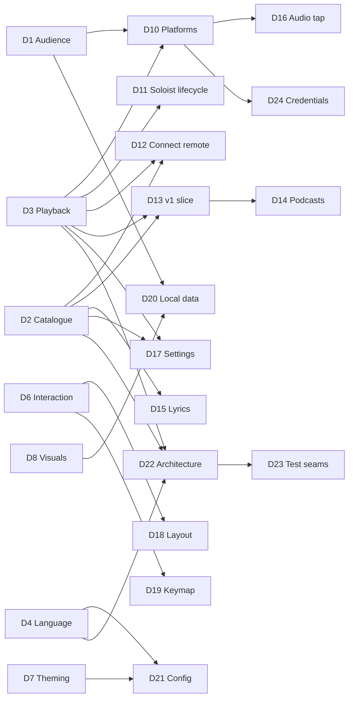

# Design tree

The map of every decision this project has to make, following Matt Pocock's
[grilling](https://github.com/mattpocock/skills/blob/main/skills/productivity/grilling/SKILL.md)
method:

- Each decision lists the decisions it **depends on**.
- The **frontier** is every open decision whose dependencies are all settled. A grilling
  **round** asks the whole frontier at once.
- **Facts** are looked up by the agent (see [`research/`](research/)). **Decisions** are the owner's.
  The agent recommends; it never decides.
- Hard-to-reverse, surprising decisions that were real trade-offs become ADRs in `docs/adr/`.
  Resolved vocabulary goes to `GLOSSARY.md`. Both files are created lazily, when the first entry exists.
- Nothing gets implemented until the owner confirms the frontier is empty and understanding is shared.

Status: `open` · `frontier` (askable now) · `settled` · `prototype` (needs something to react to,
so it cannot be settled by talking)

## Decisions

| ID | Decision | Depends on | Status | Outcome |
|----|----------|-----------|--------|---------|
| D1 | Audience: personal tool vs public open-source release | none | settled | Personal tool first; maybe open-source later. More features beat publishability. |
| D2 | Catalogue backend and ToS risk appetite (where Home, search and library data come from) | none | settled | Private API as primary catalogue source, official Web API as fallback. ADR-0002. Risk researched: `research/2026-10-private-api-risk.md`. |
| D3 | Playback engine (Soloist / librespot / both) | none | settled | Soloist (owner has Premium). The 90-day refresh must be painless → auto-update from Spotify's CDN. ADR-0001. |
| D4 | Language & TUI framework | none | settled | Rust + ratatui. |
| D5 | Rendering tiers (text-cell baseline vs kitty graphics) | none | settled | Pixel tier (kitty graphics: kitty, ghostty, wezterm) is the primary target; cell tier is the fallback. |
| D6 | Interaction model (how to be keyboard-first *and* mouse-friendly without 1400 binds) | none | settled | Desktop-app layout, fully clickable, context menus, command palette, which-key popups, hint bar. |
| D7 | Theming model | none | settled | btop-style TOML themes, bundled gallery, live picker, album-adaptive theme, transparency, themes drive visuals. |
| D8 | Which visuals/widgets to prototype first | none | settled | Five designs ship as built-in layout + theme pairs; **Singularity is the default**. Singularity = gravity-well pane + neighbouring borders bending toward it (structure only). Idle takeover: after 3 min (configurable) the visible hole breaks out of its pane and gobbles the UI; Shift+I / palette / config to switch it off. Pixel ember kept for now (not quite the remembered one). |
| D9 | Project name | none | settled | **Singularity**. |
| D10 | Platform scope (Linux-only?) | D1, D3 | settled | Linux first, **macOS second**, never Windows. macOS research: `research/2026-10-macos.md`. Engine choice on macOS → D25. |
| D11 | Soloist lifecycle: who starts it, setup wizard (API key, pairing), expiry handling | D3 | settled | The Daemon supervises Soloist: setup wizard (API key → keyring, one-time pairing), silent auto-update from the CDN between tracks. (Folded into D22.) |
| D12 | Remote-controlling other Connect devices (phone, desktop app, speakers) | D2, D3 | settled | Yes: control and transfer between all Connect devices. |
| D13 | v1 feature slice (first usable milestone) | D2, D3 | settled | v1 = stop opening the official app: Home, search, library, album/artist pages, queue, devices, playback, black hole + spectrum + lyrics, one layout + theme picker. Playlist editing, stats, Settings screen, more layouts and visuals in v1.x. |
| D14 | Podcasts & audiobooks in scope? | D2, D13 | settled | Podcasts in v1.x (show pages, episodes, resume position); audiobooks later. |
| D15 | Lyrics source (internal color-lyrics vs LRCLIB vs both) | D2 | settled | Spotify's synced lyrics first, LRCLIB as fallback. |
| D16 | Audio tap for visualisers (PipeWire capture of the player node) | D3, D10 | settled | No real alternative: PipeWire monitor of the Engine node (Linux), Core Audio process tap (macOS). Lives in the Daemon. |
| D17 | In-app Settings screen: which Spotify settings are controllable | D2, D3 | settled (for now) | Spike fact: Soloist's CLI exposes no quality, crossfade or normalisation options (only output device, initial volume, cache size). Remaining: can the private API set account playback settings? Spike 1/2. **Answer (#13, 2026-10-18): not from Singularity yet.** Soloist carries a Connect feature flag `supports_remote_audio_quality_control` and the HiFi/AudioQuality protos, but no command for setting it is visible, and probing it live would change the owner's device setting. Lossless stays a once-per-device step on the phone; the wizard, the health check and the stream Pane all say how. |
| D18 | Layout system (fixed presets vs free tiling vs presets + slot swapping) | D6 | settled | (b) in v1: built-in layouts, swappable slots, drag-to-resize, save as your own layout. The layout engine is a split tree from day one, so (c) free tiling becomes a v1.x *layout edit mode*. Research: `research/2026-10-free-tiling.md`. |
| D19 | Default keymap flavour (arrows/standard vs vim) | D6 | settled | Standard keys default (arrows, Enter, Space, Ctrl+K); vim preset as a one-line option; everything remappable. |
| D20 | Local data: listening log/stats, caches, privacy | D1, D8 | settled | Local listening log + nightly library backups, on by default. Privacy: local only, never uploaded, no telemetry, owner-only file permissions, export/delete commands. |
| D21 | Config format, locations, hot-reload | D4, D7 | settled | `~/.config/singularity/` (`config.toml`, `keys.toml`, `themes/`, `layouts/`), hot-reload. **Requirement:** the Settings screen and the files are one source of truth, edits preserve comments and formatting, and config is schema-versioned with automatic migrations so app updates never break it. |
| D22 | Architecture & crate/module boundaries | D2, D3, D4 | settled | Two processes: `singularityd` Daemon (user service) + `singularity` Client. ADR-0003. |
| D23 | Test seams | D22 | open | After D27. |
| D24 | Credential storage (KWallet/Secret Service vs files) | D2, D3, D10 | settled | OS password store (KWallet/Secret Service on Linux, Keychain on macOS); owner-only file fallback with a warning. |
| D25 | macOS Engine (Spotify.app over Connect vs librespot) | D10 | settled | The hidden official Spotify app as the macOS Engine (lossless, controlled over Connect); librespot fallback. |
| D26 | Where visuals are computed (CPU vs GPU compute) | D4, D5 | settled | GPU (wgpu compute) first, CPU fallback; frames reach kitty via shared memory. ADR-0004. Measured 626% → 14% CPU for a full-res hole. Low-power adapter (iGPU) by default, `gpu` setting to pick the dGPU (#20, owner 2026-10-18); 10 fps when unfocused. |
| D27 | Daemon↔Client protocol & local socket | D22 | settled | Local Unix socket, versioned length-prefixed messages; the audio spectrum streams over it at 60 Hz so several Clients share one tap. |
| D28 | Arrow keys in content Panes; Home scrolling | D19 | settled | Arrows + Enter navigate the focused Pane (Home Cards, later lists), like the desktop app; seek is Shift+←/→ (±5 s) and `,`/`.` (±1 s); ←/→ still seek in Panes with nothing to navigate. Home scrolls by whole rows and each Shelf sideways by whole Cards, so covers are never cut. |

## Known impossibilities (facts, not decisions)

- **Offline downloads**: DRM-protected and not exposed by any engine. Out of scope.
- **Lossless via librespot**: not supported and not planned upstream. Only Soloist streams lossless.
- **Home / Made For You / Browse via the official Web API**: no such endpoints exist.

## Round log

- **Round 1** (2026-10-17): D1–D9 asked. All settled except D8, which became a prototype (6 directions). Owner
  asked for in-depth private-API risk research (done) and a painless Soloist refresh (found: public CDN, auto-update possible).
- **Round 2** (2026-10-17): D8 reaction, D10, D11+D22 (process model), D12, D13, D15, D19, D20, D21 asked.
  Everything settled. D10 expanded to macOS (researched). D8 produced detailed feedback → prototype iteration 2.
  Facts found: the "popular terminal black hole" is s0xDk/ghostty-blackhole (MIT, ~1.7k★), now ported. The CPU
  cost of pixel visuals is high (~4 cores for a full-quality hero hole), which raised D26.
- **Round 3** (2026-10-17): D8 iteration-2 reaction, D14, D24, D25, D26 asked, plus the GitHub repo.
  All settled. D8 iteration 3 built (see the D8 row). The GPU path was prototyped and measured (ADR-0004). Private repo
  `publicusr/singularity` created. Black hole search: couldn't identify an orange/red pixel-art terminal
  black hole with confidence, so the owner may supply a link; a pixel-art look was built meanwhile.
- **Round 4** (2026-10-17): D8 iteration-3 reaction, D18, D27, shipping set, Phase 1 go-ahead asked. All settled.
  Owner asked for: more polished bending around the well (done: border lines re-drawn as braille, moving only
  sideways, with a moat around the well); the idle takeover using *the* hole from the well (done); a 3–5 min idle timer
  (3 min) with an easy off switch (Shift+I, palette, config); an assessment of free tiling (moderate effort, see research).
  Phase 1 started: spike 1 (Soloist control + audio tap) built, waiting on the owner's API key and pairing.
- **Phase 1** (2026-10-17): all spikes ✅. Soloist: pair, control, events, expiry, audio tap, and **lossless FLAC** once the
  device's quality is set to Lossless (it's per Connect device). Private API: device-code login + Pathfinder `home`
  gave the owner's real Home feed (31 shelves, ~1.5 s). Open: D17 (can Singularity set the device quality itself, via
  connect-state, instead of the phone?) and the automatic refresh of Pathfinder query hashes.
- **Phase 2** (2026-10-17): spec written (`docs/SPEC.md`), 22 tickets published (#2–#23), plus #24 from owner feedback.
  Built and closed #2, #3, #4, #7. Owner test: "everything feels good", but seek dragging must be precise to 1 s (#24).
  Handoff: `docs/HANDOFF.md`.
- **#24 seek precision** (2026-10-17): pixel-precise pointer via SGR-Pixels (DECSET 1016) on kitty/Ghostty/WezTerm (not
  in tmux; `SINGULARITY_PIXEL_MOUSE=0|1` overrides); elsewhere the press jumps to the cell and the drag then moves 1 s per
  cell (Shift/Ctrl/Alt: coarse absolute). Target time in a tooltip, one seek on release. Wheel ±1 s (Shift ±5 s),
  Shift+←/→ ±1 s; nudges coalesce (180 ms) into one command. Volume: same drag, wheel 1 %.
- **#8 Home** (2026-10-17): D28 asked and settled (both recommendations accepted). Home renders shortcuts grid, Shelves of
  square cover Cards and the feed tail as a grid ("More for you"); covers fetched lazily from the image CDN into
  `~/.cache/singularity/covers` (200 MB, pruned by age). Pixel tier: kitty images transmitted once, then only placed
  (z=-1); any cover under a popup steps down to half-blocks for that frame. Short Panes get smaller square covers. Click
  plays, right-click menu (Play / Go to / Copy link via OSC 52; Add to queue for single tracks). `--fake-catalogue <json>`
  serves a recorded feed for UI work.
- **#9 Library** (2026-10-17): owner allowed live read-only probes and quiet test plays. Facts in
  `research/2026-10-library-and-connect.md`: Soloist can't start a context at an offset; a Connect `play` with
  `skip_to.track_index` from a hidden controller (ConnectRemote) can, for albums, playlists and Liked Songs. Built:
  sidebar (Home, Liked Songs, playlists with folders indented, albums, artists), track lists that stream in page by page,
  header sort (asc → desc → list order), `/` filter, double-click/Enter plays from that track; the Engine plays the track
  alone if Connect fails. Esc inside a list goes back to Home.
- **#15 AudioTap** (2026-10-17): the Daemon taps Soloist's own PipeWire stream (`application.name="Spotify"` without a
  process binary, so the official app is never picked up) with `parec --monitor-stream`, only while a Client listens and
  only while playing. 2048-pt FFT at 30 Hz, 64 log bands, bass-flux onsets, automatic gain against the track's own
  loudness envelope (re-seeded on volume changes). Frames go only to subscribed Clients and stop after silence. Spectrum,
  loudness history and VU Widgets fill the `fft` and `loudness` Panes. Cost: analysis 0.04 % + parec < 0.1 % of a core.
  `--fake-engine` feeds the tap a synthetic groove.
- **#16 Black hole** (2026-10-17): Visual engine in the Client (`client/src/visual/`): the WGSL tracer on wgpu with
  persistent buffers, the CPU tracer of the same model (rayon, 420 px cap), equal within tolerance (test). Pixel tier:
  the hole is an animated kitty image (re-sent each frame, shm on kitty, z=-1 under text); cell tier: half-blocks. The
  gravity well's frame sags with the bass; neighbouring borders bend toward it (structure only, tested). `v`, a click
  or the palette cycles the Disk looks (Inferno first, as in the prototype; Pixel ember at 1/5 resolution, dithered).
  Unfocused, the Client drops to 10 fps (no terminal reports "hidden"). Budget met: 16.5 % / 6.5 % of a core.
- **Owner feedback** (2026-10-18): the black hole flickered (fixed: double-buffered kitty frames, 30 fps pace,
  redraws capped at 60/s) and clicking an album played it (fixed: Cards open their track list; ▶ Play there). The Client
  now replaces an outdated Daemon by itself after a rebuild.
- **#5 Setup & health** (2026-10-18): secrets in the keyring via `secret-tool` (Soloist key and, migrated on the next
  connect, the Spotify login), owner-only file fallback with a notice; `SINGULARITY_NO_KEYRING=1` for tests. Soloist's
  output is piped through the Daemon: stream format (codec, bitrate, average, rate), build lifetime, rejected key and
  a locked data dir are parsed from it, and the log rotates instead of being truncated. First-run wizard (requirements
  up front, masked key entry with paste, download, pairing, login, audio check), Health check in the palette, stream
  stats Pane with a LOSSLESS badge and the exact fix when it isn't.
- **#12 Queue** (2026-10-18): Soloist only appends, so play next / remove / clear go through ConnectRemote as a Connect
  `set_queue` (the player's `next_tracks` from the cluster, edited, sent back with its `queue_revision`; only
  `provider=queue` entries can be removed). Verified live on the owner's (paused) Soloist with one test track, added and
  removed. Queue entries Soloist sends bare get names from `getTrack` (cached). Queue Widget: now playing, Next in queue,
  Next from <context>, Autoplay (marked); right-click or Delete edits; track rows got a context menu (play from here,
  play next, add to queue, copy link).
- **#14 Lyrics** (2026-10-18): Spotify's `color-lyrics` (via the Catalogue session; Musixmatch, line-synced) with
  LRCLIB as fallback (artist, title, album, duration only), cached per track including "none". Widget: current line
  lit and held ~40 % down, `[mm:ss]` stamps like a log (the Pane is `tail -f lyrics.log`), click a line to seek, unsynced
  lyrics scroll, calm empty state, credit line. Lyrics are only asked for while a lyrics Pane is on screen.
- **#11 Album & artist pages** (2026-10-18): artist pages from `queryArtistOverview` (▶ Play, monthly listeners,
  Popular with play-from-here in the artist's context, Shelves: popular releases, albums, singles and EPs, appears on,
  fans also like, drawn by Home's Card renderer); album pages are track lists with a header (artists as links, year,
  label). History: back/forward stacks of pages (Alt+←/→, Esc/Backspace back), each list keeps its sort and scroll.
  Every artist and album name is a link (track rows, the player bar, list headers, popular tracks). Mouse back/forward
  buttons aren't possible yet: crossterm drops SGR buttons 8/9 (would need our own input parser).
- **#10 Search** (2026-10-18): `searchDesktop` (variables verified live), cached 5 min; superseded searches are skipped in
  the Daemon and the Client debounces (≥ 2 characters, 300 ms quiet), so typing never storms. Search page (sidebar row,
  palette, Ctrl+L): chips All · Songs · Artists · Albums · Playlists · Podcasts (click or Tab), songs as a playable list
  (double-click, right-click menu, artist links), other types as Card Shelves (or a grid under their chip), track Cards
  play. Recent searches: remembered when a result is used, kept owner-only in `~/.local/state/singularity/`.
- **#13 Devices** (2026-10-18): ConnectRemote starts with the Catalogue session and follows the dealer's cluster
  pushes: a live device list, and while another device plays, its playback is what Clients see and the transport goes
  to it over Connect (pause/resume/skip/seek/volume/shuffle/repeat). Connect's `transfer` endpoint answers 500 to this
  session, so moving playback is a `play` on the target with the same context, track (`skip_to`), position (`seek_to`)
  and `initially_paused`; verified live both ways (owner's desktop app ↔ Singularity, paused). Fixed on the way: after
  any Connect failure the remote was dropped, and the dealer can't start twice on one session, so Connect features died
  until the next login. Device picker: `d`, the palette, or the player bar's ⧉ label. D17 answered (above).
- **#22 Like/follow** (2026-10-18): Daemon: `SetSaved {uri, saved}` → `addToLibrary`/`removeFromLibrary`
  (`libraryItemUris`), `CheckSaved {uris}` → `areEntitiesInLibrary` (`lookup[].data.saved`, verified live read-only),
  `Event::Saved` carries the truth (the old value on failure, for rollback). Client (`client/src/saved.rs`): optimistic
  toggles settled by `Event::Saved`; answers to older toggles are ignored while a newer one is out. ♥/♡ after the title
  in the player bar (click, key `l`, palette), "Save to / Remove from Liked Songs" (and Your Library / Follow wording
  by kind) in every track and Card menu, ♡ Save / ♥ Saved on album and playlist headers, + Follow / ✓ Following on
  artist pages. Removing a saved playlist takes a second click (it may be your own). Liked Songs is patched in place
  (a like lands on top, an unlike leaves, a rollback restores the row where it was; counts follow) and seeds what's
  liked. The playing track and every opened page re-ask, so changes from other devices show.
- **#21 MPRIS + notifications** (2026-10-18): `daemon/src/mpris.rs` (zbus 5.19; 6.0 was two days old) owns
  `org.mpris.MediaPlayer2.singularity` and follows `Hub::playback`, so it also shows another device's playback; its
  methods go through the same transport routing as Clients (`lib.rs: transport`). Player: play/pause/stop (= pause),
  next/previous, Seek (past the end = next) and SetPosition (ignored for a stale track id), OpenUri (`spotify:` URIs and
  open.spotify.com links), Volume, Shuffle, LoopStatus; Metadata with track id, length, title, artists, album,
  `mpris:artUrl` (the cover URL) and `xesam:url`; Seeked on jumps (> 1.5 s off the extrapolated position).
  Notifications (`org.freedesktop.Notifications`, each replacing the last, transient, cover as a cached file) are
  opt-in with `SINGULARITY_NOTIFY=1` until config files (#20). `SINGULARITY_DBUS=<address>|off` picks the bus; a fake
  Engine stays off the session bus unless asked. Soloist has no D-Bus connection, so there's no second player. Verified
  with real `playerctl` on a private bus (pty scenario `mpris`).
- **#6 Soloist auto-update** (2026-10-18): `daemon/src/update.rs`. The CDN (`soloist-builds.spotifycdn.com`, sends
  ETag and Last-Modified, verified 2026-10-18) is checked at start, then daily, every 6 h in a build's last week, and
  after failures at 15 min doubling to 6 h; the old build always stays. A new build is unpacked into `soloist.new/`,
  must answer `--version`, and is installed by renaming directories (previous kept as `soloist.old/`), which is safe
  under a running Soloist. The SoloistEngine restarts into it only at a quiet moment: paused or idle at once, else at
  the next track change (the new track then starts over); playback is picked up through ConnectRemote (`resume`, the
  generalised transfer: context, track, position, paused), else by the Engine alone. Installs from before tracking are
  adopted when unpacked after the CDN's Last-Modified (no pointless re-download). The expiry left the stream Pane; the
  health check shows version, build date and days left ("updates itself"), and warns only under 3 days. Verified in a
  pty with a stand-in Soloist (`tools/pty/fake_soloist.py`) and a fake CDN: v2 staged while v1 played, taken over at
  the next track, playback continued.
- **#20 Config files** (2026-10-18): new crate `singularity-config` (toml_edit 0.25), used by Daemon and Client.
  `~/.config/singularity/config.toml` and `keys.toml` are written with comments on first run; `schema = 1` with a
  migration chain that edits the document in place (`rename` keeps a key's spot and comments; a v1→v2 test proves it
  byte for byte); app edits go through `set` (comments and layout stay); saves are noticed by mtime+size once a second
  and apply live in both processes; bad values fall back to defaults and are reported (toast / Daemon log), never fatal.
  Settings so far: `notifications.track_change` (replaces `SINGULARITY_NOTIFY`; palette toggle writes the file),
  `visuals.gpu` (low-power default, high-performance switches adapter on the next frame), `visuals.unfocused_fps` (10).
  Keys: actions have ids (`like`, `play_pause`, …); `preset = "standard" | "vim"` (vim: h/j/k/l, g/G, Ctrl+D/U move;
  like moves to `f`); a user binding replaces that action's keys and takes them from others; a key bound twice is
  reported and the first (by name) keeps it; unknown actions/keys are reported. Movement aliases are off while typing.
  Help screen, hint bar and palette show the keymap in use. The pty harness now gives every run scratch config/state.
- **#18 Designs and themes** (2026-10-18): `design.rs` (five Designs: Layout preset, Themes, Disk look, player-bar
  prompt, Pane titles), `theme.rs` (built-in Themes incl. Cockpit's 5 and Terminal's 3 variants, theme files with
  `base` inheritance, per-Pane border colours, numbered titles, scanlines), `looks.rs` (switching, `t`, the pickers
  with live preview, Esc puts back, Enter keeps in `[ui]` of config.toml; `themes/` re-read when it changes, also while
  the picker is open; an `_example.toml` is written, files starting with `_` are skipped), `widgets.rs` (Now playing,
  levels, listening placeholder for #23, rain, scope rebuilt from the bands since the Daemon sends spectra, `top` from
  /proc). Every Design keeps a `home` Pane (browsing needs one), so Cockpit and Terminal differ slightly from the
  prototype. `ui.transparent` hands the theme's black to the terminal. Spectrum frames are requested whenever an audio
  Widget is on screen (re-evaluated on design switches). Layout gained `Size::Last` (fixed right/bottom column).
- **#19 Slots and saved layouts** (2026-10-18): `layouts.rs`. Slots swap within curated groups (audio: spectrum,
  loudness, levels, scope, rain; side: lyrics, queue, Now playing, stream, top, listening) by `v` on the focused Pane
  or the ◂ ▸ in its title, skipping Widgets already on screen; Home, the library and the black hole keep their Panes
  (`v` on the well still cycles Disk looks). Dragging and window resizes clamp by each subtree's own minimum size (a
  test drags every divider of every Design to extremes at several sizes: no overlap, no Pane under its minimum; found
  and fixed nested splits shrinking to one row). "Save layout as…" writes `layouts/<name>.toml` (the split tree,
  ratios written exactly, one split per line as TOML 1.1 inline tables); saved layouts follow the built-in Designs in
  the picker, the one in use is `ui.layout`, and it comes back identically after a restart (unit test and pty).
- **#17 Idle takeover ✅** (2026-10-18): `visual/idle.rs` (break-out from the hole's Pane or the top-right
  corner, Lissajous drift, body dimmed, cells lensed with the prototype's `lens_cells`, the hole as kitty image 2 under
  the text or half-blocks), `BlackHole::free_frame` (free centre, no stars; `Frame.center` in CPU and GPU), App idle
  clock with the waking input swallowed (`wake()` in key/pointer/paste), Shift+I writes `idle.enabled`, palette preview,
  `[idle] enabled/minutes` in config.toml, the well empty meanwhile. App tests: the waking key/click isn't acted on (the
  first `n` sends no `Next`, the second does), Shift+I persists across a restart, the well reads "the well is empty".
  pty `idle-pixels`/`idle-cells`: the free hole goes up as z=-1 frames (~19/s, under the lensed text), is deleted on
  wake, the well's own image comes back, and the waking Space doesn't pause.
- **Owner answers** (2026-10-18): keep the 10 fps slowdown when the terminal is unfocused; keep the black hole on the
  low-power adapter (iGPU) and add a `gpu = "low-power" | "high-performance"` setting in #20.
- **Round (#23 local data)** (2026-10-18), owner said yes to all five: a Play is ≥30 s (or half a shorter track),
  logged when the track changes or stops, Connect devices included and named; nightly backup = Liked Songs + owned
  playlists in full, followed ones by name + link, ~1 request/s; keep 14 nightlies + the first of each month for a
  year; export = one JSON file (log + latest backup) to Downloads, delete asks twice; Cockpit's Pane = 26-week heatmap
  of minutes per day + "N h this year · top: Artist · streak N days".
- **#23 Listening log and library backups ✅** (2026-10-18): `daemon/src/store.rs` (LocalStore: SQLite via rusqlite
  0.40 bundled, `plays` with a local `day` column, `Recorder` (wall-clock playing time, pauses don't count),
  `summary` (local days via `localtime_r`, no time-zone crate), backups `backups/library-YYYY-MM-DD.json` with
  retention, export, delete + VACUUM; files 0600, `backups/` 0700), `backup.rs` (one `CatCmd::Query` at a time, 1 s
  apart, so browsing isn't held up; owned = `ownerV2.data.username` equals the session's; a playlist whose
  `revisionId` is unchanged is copied from last night's backup, not fetched; checked at start and hourly, due after
  24 h). Protocol (additive): `GetListening`, `ExportLocalData`, `DeleteLocalData`, `Event::Listening`, broadcast
  after each logged play and after a delete. `SINGULARITY_DATA=<dir>|off`; a fake-Engine Daemon keeps no log unless
  asked. Client: Cockpit's listening Pane (week columns, Monday on top; short Panes stack two days per cell in
  half-blocks), palette Export / Delete (a second run within 10 s confirms). The fake Catalogue answers raw queries in
  Spotify's shapes. pty `listening`: seeded scratch log, a 31 s play shows up live, backup taken in 10 s (paced),
  export 0600 with the backup inside, delete empties the Pane and removes the backups.
- **Owner test round 1** (2026-10-18), feedback in 9 points; my findings, and the questions put to the owner (pending):
  - Found first: the owner's running Daemon was the 00:08 build (started 00:12, before `c026772` "Client replaces an
    outdated Daemon"), so it ignored the new Clients' `Shutdown`. Everything tested ran new Client screens on an old
    Daemon (no like/follow, MPRIS, config following, listening log). Owner to restart it once; fix so a Daemon that
    ignores `Shutdown` is stopped anyway (peer pid via `SO_PEERCRED`, SIGTERM).
  - 1 + 6 wheel in track lists / library "works 50/50": over a row's artist or album name the hit is `Hit::Link`, which
    the wheel handler ignores. Wanted: the highlight follows the wheel. Small.
  - 2 Home drops a Shelf row unless it fits whole, and scrolls a row at a time. Fix: line-based scrolling, rows clipped
    at both edges (kitty placements can crop the source; half-blocks clip by row). Medium.
  - 3 a clickable back (◂) / forward (▸) in the main Pane's title while there's history. Small.
  - 4 loudness "maxed at 10 %": by design (D16 automatic gain, the tap is post-volume). Proposal: meters show the real
    level (follow the volume), spectrum/Visuals keep auto gain. Small.
  - 5 lyrics: Spotify's, then LRCLIB, already there (#14); misses are logged at debug only. Re-test after the Daemon
    restart; say why when there are none. Idea: Genius as an opt-in last fallback (no lyrics API: search via its API or
    site, scrape the page; unsynced text only; against Genius' terms, brittle). Medium.
  - 7 tint covers and the black hole with the Theme: feasible (gradient-map luminance onto the Theme's ramp, once per
    cover and Theme, both tiers; the hole: a post-pass in the CPU tracer and a uniform in the WGSL). Medium.
  - 8 drag to reorder the queue: feasible over Connect `set_queue` (already used for remove / play next); likely only
    the songs you queued yourself, to be verified quietly. Medium.
  - 9 fullscreen: reproduced at 256×68 (pty `PTY_COLS`/`PTY_ROWS`): the well gets very wide, the track list stretches,
    the queue is mostly empty. The hole renders round here; the owner sees it stretched (cell size? screenshot asked).
    Proposal: the well keeps a ~16:10 shape on wide terminals and the middle gets the width; track-list columns capped.
  - Also seen at 256×68: a kitty escape printed as text (`Ga=…`) in a track row once; harness or real, to check.
- **Owner answers, round 1** (2026-10-18): yes to 1–4 and 6–9 (queue drag limited to own songs "for now, may change
  after testing"). On 5: after the Daemon restart lyrics work and sync "works very well"; new bug: at half-monitor
  width long lines are cut off (wrap them). Genius parked: it has no timings, so it could only scroll at the song's
  pace; asked whether to keep it. Owner's fullscreen screenshot: the hole is round, the Pane is very wide (fixed by
  #31); the right column and the bottom hint row looked cut off (checked in #31). Owner screenshots stay out of git
  (`docs/screenshots/` ignored: personal data). Tickets: #25 stale Daemon, #26 wheel/highlight, #27 Home lines,
  #28 back/forward, #29 meters, #30 lyrics wrap, #31 wide terminals, #32 queue drag, #33 Theme tint.
- **#25 Stale Daemon ✅** (2026-10-18): the Client reads the Daemon's pid from the socket (`SO_PEERCRED`) before asking
  it to make way; if it still answers 5 s later and `/proc/<pid>/exe` is a `singularityd` (also "(deleted)" after a
  rebuild), SIGTERM, SIGKILL after 2 s, then it starts its own. Daemon test knob `SINGULARITY_IGNORE_SHUTDOWN`.
  Unit test (a renamed `sleep` is stopped, a plain one isn't); pty `stale_test.py`: replaced 5.2 s after connecting.
- **#26 Wheel moves the highlight ✅** (2026-10-18): the wheel goes by the Pane under the pointer (`pane_at`), not the
  hit under it, so a row's artist/album links no longer swallow it. Over a track list or the library it moves the
  highlight one row per notch (Shift: a page), the list follows, and the Pane takes focus so the highlight shows.
  Popups keep the wheel to themselves. Test wheels over an artist link and the library; pty `wheel`.
- **#27 Home by lines ✅** (2026-10-18): `HomeView.offset` (lines) replaces the first-row index; rows are drawn with an
  `i32` y and clipped to the Pane (text lines, Card hits, covers). A part-visible cover is the same upload placed with
  a source crop (kitty `x,y,w,h`; `Kitty::place_cropped`), or its visible half-block rows (`blit_halfblocks_from`).
  2 lines per wheel notch; keyboard moves keep the selected row whole in view. Search and artist pages share it.
  The pty harness had two bugs behind the stray `Ga=` text and a misplaced hole: a read ending inside `\x1b_G`
  went to pyte as text, and an image's position came from a regex over a possibly split cursor move; it now keeps
  the partial escape and places images at pyte's own cursor, as kitty does. Its compositor honours crops. pty
  `home-scroll`.
- **#28 Back / forward arrows ✅** (2026-10-18): the main Pane's title starts with ◂ ▸ whenever there's history
  (`Hit::History(±1)` → `go_back` / `go_forward`); the one with nowhere to go is dimmed. Title built from spans
  (number, arrows, name). Test clicks ◂ then ▸; pty `history`.

