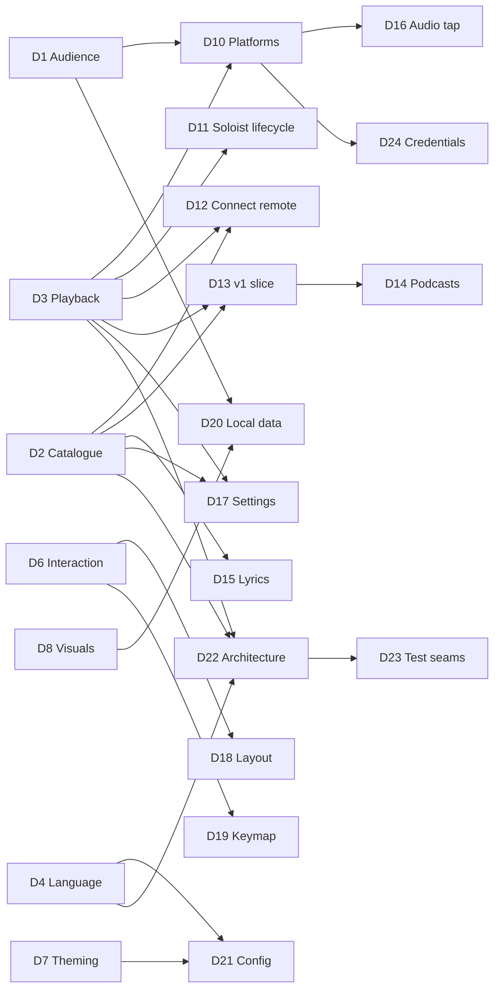

# Design tree

The map of every decision this project has to make, following Matt Pocock's
[grilling](https://github.com/mattpocock/skills/blob/main/skills/productivity/grilling/SKILL.md)
method:

- Each decision lists the decisions it **depends on**.
- The **frontier** is every open decision whose dependencies are all settled. A grilling
  **round** asks the whole frontier at once.
- **Facts** are looked up by the agent (see [`research/`](research/)). **Decisions** are the owner's.
  The agent recommends; it never decides.
- Hard-to-reverse, surprising decisions that were real trade-offs become ADRs in `docs/adr/`.
  Resolved vocabulary goes to `GLOSSARY.md`. Both files are created lazily, when the first entry exists.
- Nothing gets implemented until the owner confirms the frontier is empty and understanding is shared.

Status: `open` · `frontier` (askable now) · `settled` · `prototype` (needs something to react to,
so it cannot be settled by talking)

## Decisions

| ID | Decision | Depends on | Status | Outcome |
|----|----------|-----------|--------|---------|
| D1 | Audience: personal tool vs public open-source release | none | settled | Personal tool first; maybe open-source later. More features beat publishability. |
| D2 | Catalogue backend and ToS risk appetite (where Home, search and library data come from) | none | settled | Private API as primary catalogue source, official Web API as fallback. ADR-0002. Risk researched: `research/2026-10-private-api-risk.md`. |
| D3 | Playback engine (Soloist / librespot / both) | none | settled | Soloist (owner has Premium). The 90-day refresh must be painless → auto-update from Spotify's CDN. ADR-0001. |
| D4 | Language & TUI framework | none | settled | Rust + ratatui. |
| D5 | Rendering tiers (text-cell baseline vs kitty graphics) | none | settled | Pixel tier (kitty graphics: kitty, ghostty, wezterm) is the primary target; cell tier is the fallback. |
| D6 | Interaction model (how to be keyboard-first *and* mouse-friendly without 1400 binds) | none | settled | Desktop-app layout, fully clickable, context menus, command palette, which-key popups, hint bar. |
| D7 | Theming model | none | settled | btop-style TOML themes, bundled gallery, live picker, album-adaptive theme, transparency, themes drive visuals. |
| D8 | Which visuals/widgets to prototype first | none | prototype | Iteration 3: Zen scrapped; Event Horizon, Classic+, Cockpit and Terminal kept (Cockpit and Terminal gained palette variants, `t`). Singularity reworked: the hole lives in a *gravity well* pane instead of drifting over content, and drifting is now only an idle screensaver. New *pixel ember* disk look (orange/red pixel art) as the Event Horizon default. Owner may still supply the exact black hole they had in mind. |
| D9 | Project name | none | settled | **Singularity**. |
| D10 | Platform scope (Linux-only?) | D1, D3 | settled | Linux first, **macOS second**, never Windows. macOS research: `research/2026-10-macos.md`. Engine choice on macOS → D25. |
| D11 | Soloist lifecycle: who starts it, setup wizard (API key, pairing), expiry handling | D3 | settled | The Daemon supervises Soloist: setup wizard (API key → keyring, one-time pairing), silent auto-update from the CDN between tracks. (Folded into D22.) |
| D12 | Remote-controlling other Connect devices (phone, desktop app, speakers) | D2, D3 | settled | Yes: control and transfer between all Connect devices. |
| D13 | v1 feature slice (first usable milestone) | D2, D3 | settled | v1 = stop opening the official app: Home, search, library, album/artist pages, queue, devices, playback, black hole + spectrum + lyrics, one layout + theme picker. Playlist editing, stats, Settings screen, more layouts and visuals in v1.x. |
| D14 | Podcasts & audiobooks in scope? | D2, D13 | settled | Podcasts in v1.x (show pages, episodes, resume position); audiobooks later. |
| D15 | Lyrics source (internal color-lyrics vs LRCLIB vs both) | D2 | settled | Spotify's synced lyrics first, LRCLIB as fallback. |
| D16 | Audio tap for visualisers (PipeWire capture of the player node) | D3, D10 | settled | No real alternative: PipeWire monitor of the Engine node (Linux), Core Audio process tap (macOS). Lives in the Daemon. |
| D17 | In-app Settings screen: which Spotify settings are controllable | D2, D3 | open | Needs the Soloist spike first: its CLI has no quality/crossfade flags, so it's unclear what we can control. |
| D18 | Layout system (fixed presets vs free tiling vs presets + slot swapping) | D6 | frontier | Layout presets vs free slots: askable now that the directions have converged. |
| D19 | Default keymap flavour (arrows/standard vs vim) | D6 | settled | Standard keys default (arrows, Enter, Space, Ctrl+K); vim preset as a one-line option; everything remappable. |
| D20 | Local data: listening log/stats, caches, privacy | D1, D8 | settled | Local listening log + nightly library backups, on by default. Privacy: local only, never uploaded, no telemetry, owner-only file permissions, export/delete commands. |
| D21 | Config format, locations, hot-reload | D4, D7 | settled | `~/.config/singularity/` (`config.toml`, `keys.toml`, `themes/`, `layouts/`), hot-reload. **Requirement:** the Settings screen and the files are one source of truth, edits preserve comments and formatting, and config is schema-versioned with automatic migrations so app updates never break it. |
| D22 | Architecture & crate/module boundaries | D2, D3, D4 | settled | Two processes: `singularityd` Daemon (user service) + `singularity` Client. ADR-0003. |
| D23 | Test seams | D22 | open | After D27. |
| D24 | Credential storage (KWallet/Secret Service vs files) | D2, D3, D10 | settled | OS password store (KWallet/Secret Service on Linux, Keychain on macOS); owner-only file fallback with a warning. |
| D25 | macOS Engine (Spotify.app over Connect vs librespot) | D10 | settled | The hidden official Spotify app as the macOS Engine (lossless, controlled over Connect); librespot fallback. |
| D26 | Where visuals are computed (CPU vs GPU compute) | D4, D5 | settled | GPU (wgpu compute) first, CPU fallback; frames reach kitty via shared memory. ADR-0004. Measured 626% → 14% CPU for a full-res hole. |
| D27 | Daemon↔Client protocol & local socket | D22 | frontier | |

## Known impossibilities (facts, not decisions)

- **Offline downloads**: DRM-protected and not exposed by any engine. Out of scope.
- **Lossless via librespot**: not supported and not planned upstream. Only Soloist streams lossless.
- **Home / Made For You / Browse via the official Web API**: no such endpoints exist.

## Round log

- **Round 1** (2026-10-17): D1–D9 asked. All settled except D8, which became a prototype (6 directions). Owner
  asked for in-depth private-API risk research (done) and a painless Soloist refresh (found: public CDN, auto-update possible).
- **Round 2** (2026-10-17): D8 reaction, D10, D11+D22 (process model), D12, D13, D15, D19, D20, D21 asked.
  Everything settled. D10 expanded to macOS (researched). D8 produced detailed feedback → prototype iteration 2.
  Facts found: the "popular terminal black hole" is s0xDk/ghostty-blackhole (MIT, ~1.7k★), now ported. The CPU
  cost of pixel visuals is high (~4 cores for a full-quality hero hole), which raised D26.
- **Round 3** (2026-10-17): D8 iteration-2 reaction, D14, D24, D25, D26 asked, plus the GitHub repo.
  All settled. D8 iteration 3 built (see the D8 row). The GPU path was prototyped and measured (ADR-0004). Private repo
  `publicusr/singularity` created. Black hole search: couldn't identify an orange/red pixel-art terminal
  black hole with confidence, so the owner may supply a link; a pixel-art look was built meanwhile.
- **Round 4** (2026-10-17): D8 iteration-3 reaction, D18, D27, D23, D17 sequencing asked.
