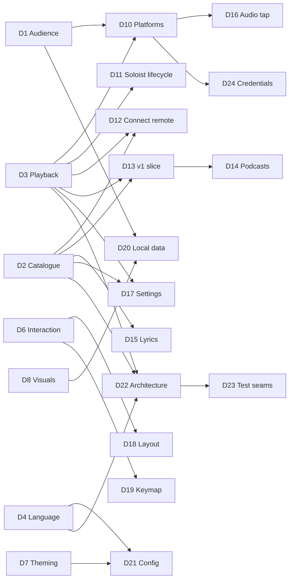

# Design tree

The map of every decision this project has to make, following Matt Pocock's
[grilling](https://github.com/mattpocock/skills/blob/main/skills/productivity/grilling/SKILL.md)
method:

- Each decision lists the decisions it **depends on**.
- The **frontier** is every open decision whose dependencies are all settled. A grilling
  **round** asks the whole frontier at once.
- **Facts** are looked up by the agent (see [`research/`](research/)). **Decisions** are the owner's.
  The agent recommends; it never decides.
- Hard-to-reverse, surprising decisions that were real trade-offs become ADRs in `docs/adr/`.
  Resolved vocabulary goes to `GLOSSARY.md`. Both files are created lazily, when the first entry exists.
- Nothing gets implemented until the owner confirms the frontier is empty and understanding is shared.

Status: `open` · `frontier` (askable now) · `settled` · `prototype` (needs something to react to,
so it cannot be settled by talking)

## Decisions

| ID | Decision | Depends on | Status | Outcome |
|----|----------|-----------|--------|---------|
| D1 | Audience: personal tool vs public open-source release | none | settled | Personal tool first; maybe open-source later. More features beat publishability. |
| D2 | Catalogue backend and ToS risk appetite (where Home, search and library data come from) | none | settled | Private API as primary catalogue source, official Web API as fallback. ADR-0002. Risk researched: `research/2026-10-private-api-risk.md`. |
| D3 | Playback engine (Soloist / librespot / both) | none | settled | Soloist (owner has Premium). The 90-day refresh must be painless → auto-update from Spotify's CDN. ADR-0001. |
| D4 | Language & TUI framework | none | settled | Rust + ratatui. |
| D5 | Rendering tiers (text-cell baseline vs kitty graphics) | none | settled | Pixel tier (kitty graphics: kitty, ghostty, wezterm) is the primary target; cell tier is the fallback. |
| D6 | Interaction model (how to be keyboard-first *and* mouse-friendly without 1400 binds) | none | settled | Desktop-app layout, fully clickable, context menus, command palette, which-key popups, hint bar. |
| D7 | Theming model | none | settled | btop-style TOML themes, bundled gallery, live picker, album-adaptive theme, transparency, themes drive visuals. |
| D8 | Which visuals/widgets to prototype first | none | settled | Five designs ship as built-in layout + theme pairs; **Singularity is the default**. Singularity = gravity-well pane + neighbouring borders bending toward it (structure only). Idle takeover: after 3 min (configurable) the visible hole breaks out of its pane and gobbles the UI; Shift+I / palette / config to switch it off. Pixel ember kept for now (not quite the remembered one). |
| D9 | Project name | none | settled | **Singularity**. |
| D10 | Platform scope (Linux-only?) | D1, D3 | settled | Linux first, **macOS second**, never Windows. macOS research: `research/2026-10-macos.md`. Engine choice on macOS → D25. |
| D11 | Soloist lifecycle: who starts it, setup wizard (API key, pairing), expiry handling | D3 | settled | The Daemon supervises Soloist: setup wizard (API key → keyring, one-time pairing), silent auto-update from the CDN between tracks. (Folded into D22.) |
| D12 | Remote-controlling other Connect devices (phone, desktop app, speakers) | D2, D3 | settled | Yes: control and transfer between all Connect devices. |
| D13 | v1 feature slice (first usable milestone) | D2, D3 | settled | v1 = stop opening the official app: Home, search, library, album/artist pages, queue, devices, playback, black hole + spectrum + lyrics, one layout + theme picker. Playlist editing, stats, Settings screen, more layouts and visuals in v1.x. |
| D14 | Podcasts & audiobooks in scope? | D2, D13 | settled | Podcasts in v1.x (show pages, episodes, resume position); audiobooks later. |
| D15 | Lyrics source (internal color-lyrics vs LRCLIB vs both) | D2 | settled | Spotify's synced lyrics first, LRCLIB as fallback. |
| D16 | Audio tap for visualisers (PipeWire capture of the player node) | D3, D10 | settled | No real alternative: PipeWire monitor of the Engine node (Linux), Core Audio process tap (macOS). Lives in the Daemon. |
| D17 | In-app Settings screen: which Spotify settings are controllable | D2, D3 | settled (for now) | Spike fact: Soloist's CLI exposes no quality, crossfade or normalisation options (only output device, initial volume, cache size). Remaining: can the private API set account playback settings? Spike 1/2. **Answer (#13, 2026-10-18): not from Singularity yet.** Soloist carries a Connect feature flag `supports_remote_audio_quality_control` and the HiFi/AudioQuality protos, but no command for setting it is visible, and probing it live would change the owner's device setting. Lossless stays a once-per-device step on the phone; the wizard, the health check and the stream Pane all say how. |
| D18 | Layout system (fixed presets vs free tiling vs presets + slot swapping) | D6 | settled | (b) in v1: built-in layouts, swappable slots, drag-to-resize, save as your own layout. The layout engine is a split tree from day one, so (c) free tiling becomes a v1.x *layout edit mode*. Research: `research/2026-10-free-tiling.md`. |
| D19 | Default keymap flavour (arrows/standard vs vim) | D6 | settled | Standard keys default (arrows, Enter, Space, Ctrl+K); vim preset as a one-line option; everything remappable. |
| D20 | Local data: listening log/stats, caches, privacy | D1, D8 | settled | Local listening log + nightly library backups, on by default. Privacy: local only, never uploaded, no telemetry, owner-only file permissions, export/delete commands. |
| D21 | Config format, locations, hot-reload | D4, D7 | settled | `~/.config/singularity/` (`config.toml`, `keys.toml`, `themes/`, `layouts/`), hot-reload. **Requirement:** the Settings screen and the files are one source of truth, edits preserve comments and formatting, and config is schema-versioned with automatic migrations so app updates never break it. |
| D22 | Architecture & crate/module boundaries | D2, D3, D4 | settled | Two processes: `singularityd` Daemon (user service) + `singularity` Client. ADR-0003. |
| D23 | Test seams | D22 | open | After D27. |
| D24 | Credential storage (KWallet/Secret Service vs files) | D2, D3, D10 | settled | OS password store (KWallet/Secret Service on Linux, Keychain on macOS); owner-only file fallback with a warning. |
| D25 | macOS Engine (Spotify.app over Connect vs librespot) | D10 | settled | The hidden official Spotify app as the macOS Engine (lossless, controlled over Connect); librespot fallback. |
| D26 | Where visuals are computed (CPU vs GPU compute) | D4, D5 | settled | GPU (wgpu compute) first, CPU fallback; frames reach kitty via shared memory. ADR-0004. Measured 626% → 14% CPU for a full-res hole. Low-power adapter (iGPU) by default, `gpu` setting to pick the dGPU (#20, owner 2026-10-18); 10 fps when unfocused. |
| D27 | Daemon↔Client protocol & local socket | D22 | settled | Local Unix socket, versioned length-prefixed messages; the audio spectrum streams over it at 60 Hz so several Clients share one tap. |
| D28 | Arrow keys in content Panes; Home scrolling | D19 | settled | Arrows + Enter navigate the focused Pane (Home Cards, later lists), like the desktop app; seek is Shift+←/→ (±5 s) and `,`/`.` (±1 s); ←/→ still seek in Panes with nothing to navigate. Home scrolls by whole rows and each Shelf sideways by whole Cards, so covers are never cut. |

## Known impossibilities (facts, not decisions)

- **Offline downloads**: DRM-protected and not exposed by any engine. Out of scope.
- **Lossless via librespot**: not supported and not planned upstream. Only Soloist streams lossless.
- **Home / Made For You / Browse via the official Web API**: no such endpoints exist.

## Round log

- **Round 1** (2026-10-17): D1–D9 asked. All settled except D8, which became a prototype (6 directions). Owner
  asked for in-depth private-API risk research (done) and a painless Soloist refresh (found: public CDN, auto-update possible).
- **Round 2** (2026-10-17): D8 reaction, D10, D11+D22 (process model), D12, D13, D15, D19, D20, D21 asked.
  Everything settled. D10 expanded to macOS (researched). D8 produced detailed feedback → prototype iteration 2.
  Facts found: the "popular terminal black hole" is s0xDk/ghostty-blackhole (MIT, ~1.7k★), now ported. The CPU
  cost of pixel visuals is high (~4 cores for a full-quality hero hole), which raised D26.
- **Round 3** (2026-10-17): D8 iteration-2 reaction, D14, D24, D25, D26 asked, plus the GitHub repo.
  All settled. D8 iteration 3 built (see the D8 row). The GPU path was prototyped and measured (ADR-0004). Private repo
  `publicusr/singularity` created. Black hole search: couldn't identify an orange/red pixel-art terminal
  black hole with confidence, so the owner may supply a link; a pixel-art look was built meanwhile.
- **Round 4** (2026-10-17): D8 iteration-3 reaction, D18, D27, shipping set, Phase 1 go-ahead asked. All settled.
  Owner asked for: more polished bending around the well (done: border lines re-drawn as braille, moving only
  sideways, with a moat around the well); the idle takeover using *the* hole from the well (done); a 3–5 min idle timer
  (3 min) with an easy off switch (Shift+I, palette, config); an assessment of free tiling (moderate effort, see research).
  Phase 1 started: spike 1 (Soloist control + audio tap) built, waiting on the owner's API key and pairing.
- **Phase 1** (2026-10-17): all spikes ✅. Soloist: pair, control, events, expiry, audio tap, and **lossless FLAC** once the
  device's quality is set to Lossless (it's per Connect device). Private API: device-code login + Pathfinder `home`
  gave the owner's real Home feed (31 shelves, ~1.5 s). Open: D17 (can Singularity set the device quality itself, via
  connect-state, instead of the phone?) and the automatic refresh of Pathfinder query hashes.
- **Phase 2** (2026-10-17): spec written (`docs/SPEC.md`), 22 tickets published (#2–#23), plus #24 from owner feedback.
  Built and closed #2, #3, #4, #7. Owner test: "everything feels good", but seek dragging must be precise to 1 s (#24).
  Handoff: `docs/HANDOFF.md`.
- **#24 seek precision** (2026-10-17): pixel-precise pointer via SGR-Pixels (DECSET 1016) on kitty/Ghostty/WezTerm (not
  in tmux; `SINGULARITY_PIXEL_MOUSE=0|1` overrides); elsewhere the press jumps to the cell and the drag then moves 1 s per
  cell (Shift/Ctrl/Alt: coarse absolute). Target time in a tooltip, one seek on release. Wheel ±1 s (Shift ±5 s),
  Shift+←/→ ±1 s; nudges coalesce (180 ms) into one command. Volume: same drag, wheel 1 %.
- **#8 Home** (2026-10-17): D28 asked and settled (both recommendations accepted). Home renders shortcuts grid, Shelves of
  square cover Cards and the feed tail as a grid ("More for you"); covers fetched lazily from the image CDN into
  `~/.cache/singularity/covers` (200 MB, pruned by age). Pixel tier: kitty images transmitted once, then only placed
  (z=-1); any cover under a popup steps down to half-blocks for that frame. Short Panes get smaller square covers. Click
  plays, right-click menu (Play / Go to / Copy link via OSC 52; Add to queue for single tracks). `--fake-catalogue <json>`
  serves a recorded feed for UI work.
- **#9 Library** (2026-10-17): owner allowed live read-only probes and quiet test plays. Facts in
  `research/2026-10-library-and-connect.md`: Soloist can't start a context at an offset; a Connect `play` with
  `skip_to.track_index` from a hidden controller (ConnectRemote) can, for albums, playlists and Liked Songs. Built:
  sidebar (Home, Liked Songs, playlists with folders indented, albums, artists), track lists that stream in page by page,
  header sort (asc → desc → list order), `/` filter, double-click/Enter plays from that track; the Engine plays the track
  alone if Connect fails. Esc inside a list goes back to Home.
- **#15 AudioTap** (2026-10-17): the Daemon taps Soloist's own PipeWire stream (`application.name="Spotify"` without a
  process binary, so the official app is never picked up) with `parec --monitor-stream`, only while a Client listens and
  only while playing. 2048-pt FFT at 30 Hz, 64 log bands, bass-flux onsets, automatic gain against the track's own
  loudness envelope (re-seeded on volume changes). Frames go only to subscribed Clients and stop after silence. Spectrum,
  loudness history and VU Widgets fill the `fft` and `loudness` Panes. Cost: analysis 0.04 % + parec < 0.1 % of a core.
  `--fake-engine` feeds the tap a synthetic groove.
- **#16 Black hole** (2026-10-17): Visual engine in the Client (`client/src/visual/`): the WGSL tracer on wgpu with
  persistent buffers, the CPU tracer of the same model (rayon, 420 px cap), equal within tolerance (test). Pixel tier:
  the hole is an animated kitty image (re-sent each frame, shm on kitty, z=-1 under text); cell tier: half-blocks. The
  gravity well's frame sags with the bass; neighbouring borders bend toward it (structure only, tested). `v`, a click
  or the palette cycles the Disk looks (Inferno first, as in the prototype; Pixel ember at 1/5 resolution, dithered).
  Unfocused, the Client drops to 10 fps (no terminal reports "hidden"). Budget met: 16.5 % / 6.5 % of a core.
- **Owner feedback** (2026-10-18): the black hole flickered (fixed: double-buffered kitty frames, 30 fps pace,
  redraws capped at 60/s) and clicking an album played it (fixed: Cards open their track list; ▶ Play there). The Client
  now replaces an outdated Daemon by itself after a rebuild.
- **#5 Setup & health** (2026-10-18): secrets in the keyring via `secret-tool` (Soloist key and, migrated on the next
  connect, the Spotify login), owner-only file fallback with a notice; `SINGULARITY_NO_KEYRING=1` for tests. Soloist's
  output is piped through the Daemon: stream format (codec, bitrate, average, rate), build lifetime, rejected key and
  a locked data dir are parsed from it, and the log rotates instead of being truncated. First-run wizard (requirements
  up front, masked key entry with paste, download, pairing, login, audio check), Health check in the palette, stream
  stats Pane with a LOSSLESS badge and the exact fix when it isn't.
- **#12 Queue** (2026-10-18): Soloist only appends, so play next / remove / clear go through ConnectRemote as a Connect
  `set_queue` (the player's `next_tracks` from the cluster, edited, sent back with its `queue_revision`; only
  `provider=queue` entries can be removed). Verified live on the owner's (paused) Soloist with one test track, added and
  removed. Queue entries Soloist sends bare get names from `getTrack` (cached). Queue Widget: now playing, Next in queue,
  Next from <context>, Autoplay (marked); right-click or Delete edits; track rows got a context menu (play from here,
  play next, add to queue, copy link).
- **#14 Lyrics** (2026-10-18): Spotify's `color-lyrics` (via the Catalogue session; Musixmatch, line-synced) with
  LRCLIB as fallback (artist, title, album, duration only), cached per track including "none". Widget: current line
  lit and held ~40 % down, `[mm:ss]` stamps like a log (the Pane is `tail -f lyrics.log`), click a line to seek, unsynced
  lyrics scroll, calm empty state, credit line. Lyrics are only asked for while a lyrics Pane is on screen.
- **#11 Album & artist pages** (2026-10-18): artist pages from `queryArtistOverview` (▶ Play, monthly listeners,
  Popular with play-from-here in the artist's context, Shelves: popular releases, albums, singles and EPs, appears on,
  fans also like, drawn by Home's Card renderer); album pages are track lists with a header (artists as links, year,
  label). History: back/forward stacks of pages (Alt+←/→, Esc/Backspace back), each list keeps its sort and scroll.
  Every artist and album name is a link (track rows, the player bar, list headers, popular tracks). Mouse back/forward
  buttons aren't possible yet: crossterm drops SGR buttons 8/9 (would need our own input parser).
- **#10 Search** (2026-10-18): `searchDesktop` (variables verified live), cached 5 min; superseded searches are skipped in
  the Daemon and the Client debounces (≥ 2 characters, 300 ms quiet), so typing never storms. Search page (sidebar row,
  palette, Ctrl+L): chips All · Songs · Artists · Albums · Playlists · Podcasts (click or Tab), songs as a playable list
  (double-click, right-click menu, artist links), other types as Card Shelves (or a grid under their chip), track Cards
  play. Recent searches: remembered when a result is used, kept owner-only in `~/.local/state/singularity/`.
- **#13 Devices** (2026-10-18): ConnectRemote starts with the Catalogue session and follows the dealer's cluster
  pushes: a live device list, and while another device plays, its playback is what Clients see and the transport goes
  to it over Connect (pause/resume/skip/seek/volume/shuffle/repeat). Connect's `transfer` endpoint answers 500 to this
  session, so moving playback is a `play` on the target with the same context, track (`skip_to`), position (`seek_to`)
  and `initially_paused`; verified live both ways (owner's desktop app ↔ Singularity, paused). Fixed on the way: after
  any Connect failure the remote was dropped, and the dealer can't start twice on one session, so Connect features died
  until the next login. Device picker: `d`, the palette, or the player bar's ⧉ label. D17 answered (above).
- **#22 Like/follow** (2026-10-18): Daemon: `SetSaved {uri, saved}` → `addToLibrary`/`removeFromLibrary`
  (`libraryItemUris`), `CheckSaved {uris}` → `areEntitiesInLibrary` (`lookup[].data.saved`, verified live read-only),
  `Event::Saved` carries the truth (the old value on failure, for rollback). Client (`client/src/saved.rs`): optimistic
  toggles settled by `Event::Saved`; answers to older toggles are ignored while a newer one is out. ♥/♡ after the title
  in the player bar (click, key `l`, palette), "Save to / Remove from Liked Songs" (and Your Library / Follow wording
  by kind) in every track and Card menu, ♡ Save / ♥ Saved on album and playlist headers, + Follow / ✓ Following on
  artist pages. Removing a saved playlist takes a second click (it may be your own). Liked Songs is patched in place
  (a like lands on top, an unlike leaves, a rollback restores the row where it was; counts follow) and seeds what's
  liked. The playing track and every opened page re-ask, so changes from other devices show.
- **#21 MPRIS + notifications** (2026-10-18): `daemon/src/mpris.rs` (zbus 5.19; 6.0 was two days old) owns
  `org.mpris.MediaPlayer2.singularity` and follows `Hub::playback`, so it also shows another device's playback; its
  methods go through the same transport routing as Clients (`lib.rs: transport`). Player: play/pause/stop (= pause),
  next/previous, Seek (past the end = next) and SetPosition (ignored for a stale track id), OpenUri (`spotify:` URIs and
  open.spotify.com links), Volume, Shuffle, LoopStatus; Metadata with track id, length, title, artists, album,
  `mpris:artUrl` (the cover URL) and `xesam:url`; Seeked on jumps (> 1.5 s off the extrapolated position).
  Notifications (`org.freedesktop.Notifications`, each replacing the last, transient, cover as a cached file) are
  opt-in with `SINGULARITY_NOTIFY=1` until config files (#20). `SINGULARITY_DBUS=<address>|off` picks the bus; a fake
  Engine stays off the session bus unless asked. Soloist has no D-Bus connection, so there's no second player. Verified
  with real `playerctl` on a private bus (pty scenario `mpris`).
- **Owner answers** (2026-10-18): keep the 10 fps slowdown when the terminal is unfocused; keep the black hole on the
  low-power adapter (iGPU) and add a `gpu = "low-power" | "high-performance"` setting in #20.
