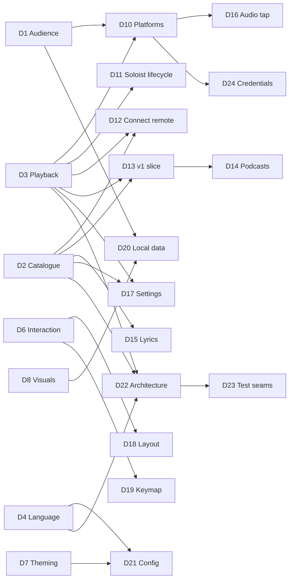

# Design tree

The map of every decision this project has to make, following Matt Pocock's
[grilling](https://github.com/mattpocock/skills/blob/main/skills/productivity/grilling/SKILL.md)
method:

- Each decision lists the decisions it **depends on**.
- The **frontier** is every open decision whose dependencies are all settled. A grilling
  **round** asks the whole frontier at once.
- **Facts** are looked up by the agent (see [`research/`](research/)). **Decisions** are the owner's.
  The agent recommends; it never decides.
- Hard-to-reverse, surprising decisions that were real trade-offs become ADRs in `docs/adr/`.
  Resolved vocabulary goes to `GLOSSARY.md`. Both files are created lazily, when the first entry exists.
- Nothing gets implemented until the owner confirms the frontier is empty and understanding is shared.

Status: `open` · `frontier` (askable now) · `settled` · `prototype` (needs something to react to,
so it cannot be settled by talking)

## Decisions

| ID | Decision | Depends on | Status | Outcome |
|----|----------|-----------|--------|---------|
| D1 | Audience: personal tool vs public open-source release | none | settled | Personal tool first; maybe open-source later. More features beat publishability. |
| D2 | Catalogue backend and ToS risk appetite (where Home, search and library data come from) | none | settled | Private API as primary catalogue source, official Web API as fallback. ADR-0002. Risk researched: `research/2026-10-private-api-risk.md`. |
| D3 | Playback engine (Soloist / librespot / both) | none | settled | Soloist (owner has Premium). The 90-day refresh must be painless → auto-update from Spotify's CDN. ADR-0001. |
| D4 | Language & TUI framework | none | settled | Rust + ratatui. |
| D5 | Rendering tiers (text-cell baseline vs kitty graphics) | none | settled | Pixel tier (kitty graphics: kitty, ghostty, wezterm) is the primary target; cell tier is the fallback. |
| D6 | Interaction model (how to be keyboard-first *and* mouse-friendly without 1400 binds) | none | settled | Desktop-app layout, fully clickable, context menus, command palette, which-key popups, hint bar. |
| D7 | Theming model | none | settled | btop-style TOML themes, bundled gallery, live picker, album-adaptive theme, transparency, themes drive visuals. |
| D8 | Which visuals/widgets to prototype first | none | settled | Five designs ship as built-in layout + theme pairs; **Singularity is the default**. Singularity = gravity-well pane + neighbouring borders bending toward it (structure only). Idle takeover: after 3 min (configurable) the visible hole breaks out of its pane and gobbles the UI; Shift+I / palette / config to switch it off. Pixel ember kept for now (not quite the remembered one). |
| D9 | Project name | none | settled | **Singularity**. |
| D10 | Platform scope (Linux-only?) | D1, D3 | settled | Linux first, **macOS second**, never Windows. macOS research: `research/2026-10-macos.md`. Engine choice on macOS → D25. |
| D11 | Soloist lifecycle: who starts it, setup wizard (API key, pairing), expiry handling | D3 | settled | The Daemon supervises Soloist: setup wizard (API key → keyring, one-time pairing), silent auto-update from the CDN between tracks. (Folded into D22.) |
| D12 | Remote-controlling other Connect devices (phone, desktop app, speakers) | D2, D3 | settled | Yes: control and transfer between all Connect devices. |
| D13 | v1 feature slice (first usable milestone) | D2, D3 | settled | v1 = stop opening the official app: Home, search, library, album/artist pages, queue, devices, playback, black hole + spectrum + lyrics, one layout + theme picker. Playlist editing, stats, Settings screen, more layouts and visuals in v1.x. |
| D14 | Podcasts & audiobooks in scope? | D2, D13 | settled | Podcasts in v1.x (show pages, episodes, resume position); audiobooks later. |
| D15 | Lyrics source (internal color-lyrics vs LRCLIB vs both) | D2 | settled | Spotify's synced lyrics first, LRCLIB as fallback. |
| D16 | Audio tap for visualisers (PipeWire capture of the player node) | D3, D10 | settled | No real alternative: PipeWire monitor of the Engine node (Linux), Core Audio process tap (macOS). Lives in the Daemon. |
| D17 | In-app Settings screen: which Spotify settings are controllable | D2, D3 | settled (for now) | Spike fact: Soloist's CLI exposes no quality, crossfade or normalisation options (only output device, initial volume, cache size). Remaining: can the private API set account playback settings? Spike 1/2. **Answer (#13, 2026-10-18): not from Singularity yet.** Soloist carries a Connect feature flag `supports_remote_audio_quality_control` and the HiFi/AudioQuality protos, but no command for setting it is visible, and probing it live would change the owner's device setting. Lossless stays a once-per-device step on the phone; the wizard, the health check and the stream Pane all say how. |
| D18 | Layout system (fixed presets vs free tiling vs presets + slot swapping) | D6 | settled | (b) in v1: built-in layouts, swappable slots, drag-to-resize, save as your own layout. The layout engine is a split tree from day one, so (c) free tiling becomes a v1.x *layout edit mode*. Research: `research/2026-10-free-tiling.md`. |
| D19 | Default keymap flavour (arrows/standard vs vim) | D6 | settled | Standard keys default (arrows, Enter, Space, Ctrl+K); vim preset as a one-line option; everything remappable. |
| D20 | Local data: listening log/stats, caches, privacy | D1, D8 | settled | Local listening log + nightly library backups, on by default. Privacy: local only, never uploaded, no telemetry, owner-only file permissions, export/delete commands. |
| D21 | Config format, locations, hot-reload | D4, D7 | settled | `~/.config/singularity/` (`config.toml`, `keys.toml`, `themes/`, `layouts/`), hot-reload. **Requirement:** the Settings screen and the files are one source of truth, edits preserve comments and formatting, and config is schema-versioned with automatic migrations so app updates never break it. |
| D22 | Architecture & crate/module boundaries | D2, D3, D4 | settled | Two processes: `singularityd` Daemon (user service) + `singularity` Client. ADR-0003. |
| D23 | Test seams | D22 | open | After D27. |
| D24 | Credential storage (KWallet/Secret Service vs files) | D2, D3, D10 | settled | OS password store (KWallet/Secret Service on Linux, Keychain on macOS); owner-only file fallback with a warning. |
| D25 | macOS Engine (Spotify.app over Connect vs librespot) | D10 | settled | The hidden official Spotify app as the macOS Engine (lossless, controlled over Connect); librespot fallback. |
| D26 | Where visuals are computed (CPU vs GPU compute) | D4, D5 | settled | GPU (wgpu compute) first, CPU fallback; frames reach kitty via shared memory. ADR-0004. Measured 626% → 14% CPU for a full-res hole. Low-power adapter (iGPU) by default, `gpu` setting to pick the dGPU (#20, owner 2026-10-18); 10 fps when unfocused. |
| D27 | Daemon↔Client protocol & local socket | D22 | settled | Local Unix socket, versioned length-prefixed messages; the audio spectrum streams over it at 60 Hz so several Clients share one tap. |
| D28 | Arrow keys in content Panes; Home scrolling | D19 | settled | Arrows + Enter navigate the focused Pane (Home Cards, later lists), like the desktop app; seek is Shift+←/→ (±5 s) and `,`/`.` (±1 s); ←/→ still seek in Panes with nothing to navigate. Home scrolls by whole rows and each Shelf sideways by whole Cards, so covers are never cut. |
| D29 | v1.x order | D13 | settled | (1) stats, (2) unbuilt v1 items + polish, (3) playlist editing, (4) Settings screen, (5) album-adaptive theme + more Visuals, (6) podcasts, (7) free tiling, (8) macOS. |
| D30 | Unbuilt v1 items | D13 | settled | Waveform seek bar and mini-player in batch 2; album-adaptive theme in batch 5 (on #33's tinting). |
| D31 | Stats | D20 | settled | A Stats page (live Wrapped: top artists/tracks/albums per week/month/year/all time, minutes, streak, play counts, listening-by-hour) + Widgets "today" and "top this week"; the heatmap stays. |
| D32 | Playlist editing scope | D2 | settled | Own playlists: create, rename/description, delete (asks twice), "Add to playlist…" picker with search, remove, drag to reorder. No folder management. Custom covers wanted "if not too hard": feasible (`research/2026-10-playlists-and-podcasts.md`). |
| D33 | Settings screen | D21 | settled | Built from config.toml (comments as descriptions), clickable, written through the comment-keeping editor; a read-only keymap tab; rebinding later. |
| D34 | Polish | D13 | settled | Mouse back/forward buttons (own input layer); ♥ on every track row (batched CheckSaved). |
| D35 | Podcasts scope | D14 | settled | Show pages + episodes, play/resume, played marks, saved shows in the sidebar, search. Audiobooks / video / downloads: feasibility looked up. |
| D36 | More Visuals | D8 | settled | Demos (`client/src/demos.rs`) judged in round 2: keep starfield, marquee, glow (#44 finishes them); drop up next (it cuts song names). |
| D37 | Free tiling | D18 | settled | Build it (batch 7), remove it if the owner doesn't like it. Parked before it was built (D59). |
| D38 | macOS | D10, D25 | settled | Last; started when the owner has the Mac ready. Pulled forward by D48. |
| D39 | Stats ranking | D31 | settled | By minutes (play counts alongside); calendar periods (week from Monday, month, year, all time). |
| D40 | Playlist covers | D32 | settled | In batch 3: a path or an image dropped on the terminal, previewed, cropped square, ≤ 256 KB JPEG, uploaded the web player's way. |
| D41 | Podcast extras | D35 | settled | Audiobooks in batch 6 if Soloist plays chapters (checked first, else dropped and reported); video podcasts as audio; downloads never. Demos as in-app Widgets (D36); spec for all of v1.x now, tickets per batch. |
| D42 | Album song into "Next in queue" | #32 | settled | Allowed one way (batch 2 polish): dropped among the queued songs it becomes a queued song there and leaves the album run; queued songs never go into the context. |
| D43 | What every Design keeps | D18 | settled | Owner rule (round 2): every built-in Design has Panes for Home, the library, the queue and lyrics; the rest is its own. |
| D44 | Where ◂ ▸ go | D6 | settled | All at the right end of a Pane's title; the main Pane's back/forward there too, as ← →. |
| D45 | Mouse back/forward buttons (#48) | D34 | settled | Dropped (owner): it needed a vendored crossterm or our own input parser; ← → in the main Pane's title do the job. |
| D46 | Waveform seek bar (#46) | D30 | settled | Removed (owner): the plain seek bar looks cleaner; the audio Widgets already show loudness. |
| D47 | Album-adaptive theme (batch 5) | D30 | settled | Dropped (owner, 2026-10-19): they like the theming as it is. More Visuals were already done in #44, so batch 5 is gone; next is batch 6 (podcasts and audiobooks). |
| D48 | When macOS is built | D38, D29 | settled | Now (owner, 2026-10-19: "I will be working on macos temporarily, the next step will be getting the TUI to run on macos"). Batch 8 goes before #62 (audiobooks) and batch 7 (free tiling); both stay planned. |
| D49 | Platform parity | D10, D38 | settled | Owner (2026-10-19): "both the existing linux version and a separate, same functionality macos version, nothing exclusive to either if possible". One codebase; OS-specific code only behind the platform seams (Engine, AudioTap, Secrets, OS media integration, autostart, process lookup). Every feature works on both or has a row in `docs/PLATFORMS.md` saying why not. |
| D50 | Paths on macOS | D49, D21 | settled (agent call, open to veto) | The same XDG-style paths as Linux (`~/.config/singularity`, `~/.local/share/…`, `~/.local/state/…`, `~/.cache/…`, the `XDG_*` variables respected), not `~/Library/…`: dotfile-friendly, one set of docs. Already what the code does. |
| D51 | How the macOS Engine works | D25, D49 | settled (agent call, open to veto) | *AppEngine*: the Daemon starts Spotify.app hidden and drives its Connect device through ConnectRemote (play, transport, queue); its playback and queue come from the Connect cluster. Platform-neutral code (only starting the app is per-OS), so the Engine choice is `[engine] kind` in config.toml, default Soloist on Linux, the app on macOS. Needs the Catalogue login; librespot stays the fallback (D25). |
| D52 | A light Engine (librespot in the Daemon) | D25, D51 | settled | Owner (2026-10-19): "600 mb and 5-25 cpu is kinda insane. Lets add the librespot lightweight player." `[engine] kind = "librespot"` on both OSes (#70): librespot's Connect receiver and player inside the Daemon, driven over Connect like the app, audio through cpal and straight into the AudioTap. 320 kbps at most. The app stays the macOS `auto` until D54 says otherwise. |
| D53 | Lossless on macOS without the Spotify app | D52, D3 | settled | Owner asked how feasible a lossless player like Soloist is on macOS. Facts: librespot can't (Spotify keeps lossless to its own players and asked librespot not to; going around that is DRM circumvention, out). The only other lossless player Spotify makes is Soloist, Linux-only (arm64 too). Option: run it in a tiny Linux VM (Apple's Virtualization framework), its PCM sent to the Daemon over vsock and played and tapped there. Feasible but a project: a VM image to build and download, pairing needs the phone to reach the VM (mDNS proxied from the Mac), the VM's memory (~150–250 MB estimated, unmeasured). Owner: "if its somehow less resources than spotify client thats hilarious and worth it, try it out": a time-boxed spike that measures it, built only if it clearly beats the app. **Spike done** (`research/2026-10-soloist-vm-spike.md`): runs; ~200–270 MB and ~1–3 % CPU estimated (a 192–256 MB VM), against the app's ~600 MB; playback and phone pairing unmeasured until the owner provides the Soloist key. |
| D54 | macOS default Engine | D52, D53 | settled | Owner (2026-10-19): librespot, "since widgets work out of the box, and it uses the least resources by far and its standalone. requiring the spotify app on top of it makes it just a second interface to an app already there working, dont love that for my player." `auto` = librespot on macOS (Soloist stays Linux's); the app remains `kind = "spotify-app"`, the lossless choice. |
| D55 | Soloist in a VM as a macOS Engine | D53 | settled | Owner (2026-10-20): yes, after the spike measured ~300 MB and ~5.6 % CPU playing FLAC. `[engine] kind = "soloist"` on macOS runs Soloist in a Linux VM the Daemon manages: lossless, standalone, the audio Widgets fed from its PCM. |
| D56 | macOS default with the VM available | D54, D55 | settled | Owner (2026-10-20): librespot stays the default (26 MB, no pairing); the Soloist VM is the setting to switch to for lossless. |
| D57 | Audiobooks on an Engine that can't play them | D41, D49, D52 | settled | Owner (2026-10-20): librespot can't (Spotify refuses it chapter keys; going around that is DRM circumvention). Audiobooks are built for every Engine: book pages, library rows and search work everywhere; on librespot, playing a chapter says "Audiobooks need Soloist or the Spotify app: switch the player in Settings". |
| D58 | Spotify's access line on books | D57 | settled | Owner (2026-10-20): book rows and the book page show Spotify's own `accessInfo.signifier` text ("Listen free until Oct 31", "Access with Audiobooks+"); a refusal to play still says so. |
| D59 | Free tiling (batch 7) | D37 | settled | Parked (owner, 2026-10-20: "lets pause on the free tiling, maybe as an idea to come back to, current state is very satisfactory"). Not built; kept as an idea (`ideas/layout.md`, research in `research/2026-10-free-tiling.md`). Next is batch 9, the audit. |
| D60 | Visuals while nothing plays | D36, #71 | superseded by D62 | Owner (2026-10-20): "slow sounds good". While nothing plays and nothing was touched for 2 s, the Client draws at most 5 frames a second (`IDLE_FPS`); a key, the mouse or music brings 30 back at once. Idle Client in the harness: pixel tier 5.5 → 2.1 %, cell tier 2.8 → 1.2 %. |
| D61 | Soloist's cache size | #71 | settled | Owner (2026-10-21): "make the cap user customizable, I'd like to have some songs cached, we can let it go for 5 gb". `engine.cache_gb` (config schema 4, Settings page), default 5, 0 = no limit, passed as `--cache-size` (Soloist's minimum 100 MB). Linux only: the macOS VM keeps 200 MB (its disk is the small cloud image). Their cache had reached 2.8 GB in four days with no limit. |
| D62 | Smooth Visuals always | D60, #71 | settled | Owner (2026-10-21): "I don't like the 5fps out of focus animations, they look choppy af so lets gut them". D60's 5 fps while nothing plays is gone; `visuals.unfocused_fps` defaults to 30 (was 10; config schema 5 moves an untouched 10 to 30, a chosen number stays). The rain runs at 1.6× without music (it stepped visibly slower). Measured cost on the owner's machine, playing and focused: ~3 % Client + ~5 % kitty. |
| D63 | Playback changed elsewhere (a phone on Connect, a Jam guest) | D3, D12 | settled | Owner's report (2026-10-23, T0005): a friend's phone playing on Singularity made the previously playing song come back. **The Daemon follows a change it didn't make; it never puts its own remembered state back** (agent call, open to veto). Two defects made up the cause: the Soloist updater restarted Soloist *because of* the phone's track change and then re-played the state it remembered (and, when it came back with a track already playing, the remembered track won); and a `get_queue` answer, a snapshot from before the change, could put the old track back in what the Daemon reports. Built: the updater takes a quiet moment only for a change its own command caused (`SoloistState::change_is_ours`), the resume waits 1.5 s and is dropped if the player came back playing something, and a queue answer only fills the queue (`phone_test.py`, contract tests). |
| D64 | Jam: hosting or joining one on a Singularity device | D3, D12, D63 | open | Question for the owner, see the round log ("T0005", 2026-10-24): Jam is Spotify's server-side shared session, hosted *by one device*; there is nothing to implement to be a good Jam host (Soloist supports Jam, and a Jam's commands arrive as ordinary Connect play/queue commands, which D63 now follows), but a guest who joins a Jam lands on the Jam's host, not on Singularity, and a headless device can't start a Jam from its own UI. ➡️ Recommendation: don't build a Jam feature now; check live that starting a Jam from the phone while it plays on Singularity works, and say in the README that a Jam can be *hosted* on Singularity but started from the phone. |

## Known impossibilities (facts, not decisions)

- **Offline downloads**: DRM-protected and not exposed by any engine. Out of scope.
- **Lossless via librespot**: not supported and not planned upstream. Only Soloist streams lossless.
- **Home / Made For You / Browse via the official Web API**: no such endpoints exist.

## Round log

- **Round 1** (2026-10-17): D1–D9 asked. All settled except D8, which became a prototype (6 directions). Owner
  asked for in-depth private-API risk research (done) and a painless Soloist refresh (found: public CDN, auto-update possible).
- **Round 2** (2026-10-17): D8 reaction, D10, D11+D22 (process model), D12, D13, D15, D19, D20, D21 asked.
  Everything settled. D10 expanded to macOS (researched). D8 produced detailed feedback → prototype iteration 2.
  Facts found: the "popular terminal black hole" is s0xDk/ghostty-blackhole (MIT, ~1.7k★), now ported. The CPU
  cost of pixel visuals is high (~4 cores for a full-quality hero hole), which raised D26.
- **Round 3** (2026-10-17): D8 iteration-2 reaction, D14, D24, D25, D26 asked, plus the GitHub repo.
  All settled. D8 iteration 3 built (see the D8 row). The GPU path was prototyped and measured (ADR-0004). Private repo
  `publicusr/singularity` created. Black hole search: couldn't identify an orange/red pixel-art terminal
  black hole with confidence, so the owner may supply a link; a pixel-art look was built meanwhile.
- **Round 4** (2026-10-17): D8 iteration-3 reaction, D18, D27, shipping set, Phase 1 go-ahead asked. All settled.
  Owner asked for: more polished bending around the well (done: border lines re-drawn as braille, moving only
  sideways, with a moat around the well); the idle takeover using *the* hole from the well (done); a 3–5 min idle timer
  (3 min) with an easy off switch (Shift+I, palette, config); an assessment of free tiling (moderate effort, see research).
  Phase 1 started: spike 1 (Soloist control + audio tap) built, waiting on the owner's API key and pairing.
- **Phase 1** (2026-10-17): all spikes ✅. Soloist: pair, control, events, expiry, audio tap, and **lossless FLAC** once the
  device's quality is set to Lossless (it's per Connect device). Private API: device-code login + Pathfinder `home`
  gave the owner's real Home feed (31 shelves, ~1.5 s). Open: D17 (can Singularity set the device quality itself, via
  connect-state, instead of the phone?) and the automatic refresh of Pathfinder query hashes.
- **Phase 2** (2026-10-17): spec written (`docs/SPEC.md`), 22 tickets published (#2–#23), plus #24 from owner feedback.
  Built and closed #2, #3, #4, #7. Owner test: "everything feels good", but seek dragging must be precise to 1 s (#24).
  Handoff: `docs/HANDOFF.md`.
- **#24 seek precision** (2026-10-17): pixel-precise pointer via SGR-Pixels (DECSET 1016) on kitty/Ghostty/WezTerm (not
  in tmux; `SINGULARITY_PIXEL_MOUSE=0|1` overrides); elsewhere the press jumps to the cell and the drag then moves 1 s per
  cell (Shift/Ctrl/Alt: coarse absolute). Target time in a tooltip, one seek on release. Wheel ±1 s (Shift ±5 s),
  Shift+←/→ ±1 s; nudges coalesce (180 ms) into one command. Volume: same drag, wheel 1 %.
- **#8 Home** (2026-10-17): D28 asked and settled (both recommendations accepted). Home renders shortcuts grid, Shelves of
  square cover Cards and the feed tail as a grid ("More for you"); covers fetched lazily from the image CDN into
  `~/.cache/singularity/covers` (200 MB, pruned by age). Pixel tier: kitty images transmitted once, then only placed
  (z=-1); any cover under a popup steps down to half-blocks for that frame. Short Panes get smaller square covers. Click
  plays, right-click menu (Play / Go to / Copy link via OSC 52; Add to queue for single tracks). `--fake-catalogue <json>`
  serves a recorded feed for UI work.
- **#9 Library** (2026-10-17): owner allowed live read-only probes and quiet test plays. Facts in
  `research/2026-10-library-and-connect.md`: Soloist can't start a context at an offset; a Connect `play` with
  `skip_to.track_index` from a hidden controller (ConnectRemote) can, for albums, playlists and Liked Songs. Built:
  sidebar (Home, Liked Songs, playlists with folders indented, albums, artists), track lists that stream in page by page,
  header sort (asc → desc → list order), `/` filter, double-click/Enter plays from that track; the Engine plays the track
  alone if Connect fails. Esc inside a list goes back to Home.
- **#15 AudioTap** (2026-10-17): the Daemon taps Soloist's own PipeWire stream (`application.name="Spotify"` without a
  process binary, so the official app is never picked up) with `parec --monitor-stream`, only while a Client listens and
  only while playing. 2048-pt FFT at 30 Hz, 64 log bands, bass-flux onsets, automatic gain against the track's own
  loudness envelope (re-seeded on volume changes). Frames go only to subscribed Clients and stop after silence. Spectrum,
  loudness history and VU Widgets fill the `fft` and `loudness` Panes. Cost: analysis 0.04 % + parec < 0.1 % of a core.
  `--fake-engine` feeds the tap a synthetic groove.
- **#16 Black hole** (2026-10-17): Visual engine in the Client (`client/src/visual/`): the WGSL tracer on wgpu with
  persistent buffers, the CPU tracer of the same model (rayon, 420 px cap), equal within tolerance (test). Pixel tier:
  the hole is an animated kitty image (re-sent each frame, shm on kitty, z=-1 under text); cell tier: half-blocks. The
  gravity well's frame sags with the bass; neighbouring borders bend toward it (structure only, tested). `v`, a click
  or the palette cycles the Disk looks (Inferno first, as in the prototype; Pixel ember at 1/5 resolution, dithered).
  Unfocused, the Client drops to 10 fps (no terminal reports "hidden"). Budget met: 16.5 % / 6.5 % of a core.
- **Owner feedback** (2026-10-18): the black hole flickered (fixed: double-buffered kitty frames, 30 fps pace,
  redraws capped at 60/s) and clicking an album played it (fixed: Cards open their track list; ▶ Play there). The Client
  now replaces an outdated Daemon by itself after a rebuild.
- **#5 Setup & health** (2026-10-18): secrets in the keyring via `secret-tool` (Soloist key and, migrated on the next
  connect, the Spotify login), owner-only file fallback with a notice; `SINGULARITY_NO_KEYRING=1` for tests. Soloist's
  output is piped through the Daemon: stream format (codec, bitrate, average, rate), build lifetime, rejected key and
  a locked data dir are parsed from it, and the log rotates instead of being truncated. First-run wizard (requirements
  up front, masked key entry with paste, download, pairing, login, audio check), Health check in the palette, stream
  stats Pane with a LOSSLESS badge and the exact fix when it isn't.
- **#12 Queue** (2026-10-18): Soloist only appends, so play next / remove / clear go through ConnectRemote as a Connect
  `set_queue` (the player's `next_tracks` from the cluster, edited, sent back with its `queue_revision`; only
  `provider=queue` entries can be removed). Verified live on the owner's (paused) Soloist with one test track, added and
  removed. Queue entries Soloist sends bare get names from `getTrack` (cached). Queue Widget: now playing, Next in queue,
  Next from <context>, Autoplay (marked); right-click or Delete edits; track rows got a context menu (play from here,
  play next, add to queue, copy link).
- **#14 Lyrics** (2026-10-18): Spotify's `color-lyrics` (via the Catalogue session; Musixmatch, line-synced) with
  LRCLIB as fallback (artist, title, album, duration only), cached per track including "none". Widget: current line
  lit and held ~40 % down, `[mm:ss]` stamps like a log (the Pane is `tail -f lyrics.log`), click a line to seek, unsynced
  lyrics scroll, calm empty state, credit line. Lyrics are only asked for while a lyrics Pane is on screen.
- **#11 Album & artist pages** (2026-10-18): artist pages from `queryArtistOverview` (▶ Play, monthly listeners,
  Popular with play-from-here in the artist's context, Shelves: popular releases, albums, singles and EPs, appears on,
  fans also like, drawn by Home's Card renderer); album pages are track lists with a header (artists as links, year,
  label). History: back/forward stacks of pages (Alt+←/→, Esc/Backspace back), each list keeps its sort and scroll.
  Every artist and album name is a link (track rows, the player bar, list headers, popular tracks). Mouse back/forward
  buttons aren't possible yet: crossterm drops SGR buttons 8/9 (would need our own input parser).
- **#10 Search** (2026-10-18): `searchDesktop` (variables verified live), cached 5 min; superseded searches are skipped in
  the Daemon and the Client debounces (≥ 2 characters, 300 ms quiet), so typing never storms. Search page (sidebar row,
  palette, Ctrl+L): chips All · Songs · Artists · Albums · Playlists · Podcasts (click or Tab), songs as a playable list
  (double-click, right-click menu, artist links), other types as Card Shelves (or a grid under their chip), track Cards
  play. Recent searches: remembered when a result is used, kept owner-only in `~/.local/state/singularity/`.
- **#13 Devices** (2026-10-18): ConnectRemote starts with the Catalogue session and follows the dealer's cluster
  pushes: a live device list, and while another device plays, its playback is what Clients see and the transport goes
  to it over Connect (pause/resume/skip/seek/volume/shuffle/repeat). Connect's `transfer` endpoint answers 500 to this
  session, so moving playback is a `play` on the target with the same context, track (`skip_to`), position (`seek_to`)
  and `initially_paused`; verified live both ways (owner's desktop app ↔ Singularity, paused). Fixed on the way: after
  any Connect failure the remote was dropped, and the dealer can't start twice on one session, so Connect features died
  until the next login. Device picker: `d`, the palette, or the player bar's ⧉ label. D17 answered (above).
- **#22 Like/follow** (2026-10-18): Daemon: `SetSaved {uri, saved}` → `addToLibrary`/`removeFromLibrary`
  (`libraryItemUris`), `CheckSaved {uris}` → `areEntitiesInLibrary` (`lookup[].data.saved`, verified live read-only),
  `Event::Saved` carries the truth (the old value on failure, for rollback). Client (`client/src/saved.rs`): optimistic
  toggles settled by `Event::Saved`; answers to older toggles are ignored while a newer one is out. ♥/♡ after the title
  in the player bar (click, key `l`, palette), "Save to / Remove from Liked Songs" (and Your Library / Follow wording
  by kind) in every track and Card menu, ♡ Save / ♥ Saved on album and playlist headers, + Follow / ✓ Following on
  artist pages. Removing a saved playlist takes a second click (it may be your own). Liked Songs is patched in place
  (a like lands on top, an unlike leaves, a rollback restores the row where it was; counts follow) and seeds what's
  liked. The playing track and every opened page re-ask, so changes from other devices show.
- **#21 MPRIS + notifications** (2026-10-18): `daemon/src/mpris.rs` (zbus 5.19; 6.0 was two days old) owns
  `org.mpris.MediaPlayer2.singularity` and follows `Hub::playback`, so it also shows another device's playback; its
  methods go through the same transport routing as Clients (`lib.rs: transport`). Player: play/pause/stop (= pause),
  next/previous, Seek (past the end = next) and SetPosition (ignored for a stale track id), OpenUri (`spotify:` URIs and
  open.spotify.com links), Volume, Shuffle, LoopStatus; Metadata with track id, length, title, artists, album,
  `mpris:artUrl` (the cover URL) and `xesam:url`; Seeked on jumps (> 1.5 s off the extrapolated position).
  Notifications (`org.freedesktop.Notifications`, each replacing the last, transient, cover as a cached file) are
  opt-in with `SINGULARITY_NOTIFY=1` until config files (#20). `SINGULARITY_DBUS=<address>|off` picks the bus; a fake
  Engine stays off the session bus unless asked. Soloist has no D-Bus connection, so there's no second player. Verified
  with real `playerctl` on a private bus (pty scenario `mpris`).
- **#6 Soloist auto-update** (2026-10-18): `daemon/src/update.rs`. The CDN (`soloist-builds.spotifycdn.com`, sends
  ETag and Last-Modified, verified 2026-10-18) is checked at start, then daily, every 6 h in a build's last week, and
  after failures at 15 min doubling to 6 h; the old build always stays. A new build is unpacked into `soloist.new/`,
  must answer `--version`, and is installed by renaming directories (previous kept as `soloist.old/`), which is safe
  under a running Soloist. The SoloistEngine restarts into it only at a quiet moment: paused or idle at once, else at
  the next track change (the new track then starts over); playback is picked up through ConnectRemote (`resume`, the
  generalised transfer: context, track, position, paused), else by the Engine alone. Installs from before tracking are
  adopted when unpacked after the CDN's Last-Modified (no pointless re-download). The expiry left the stream Pane; the
  health check shows version, build date and days left ("updates itself"), and warns only under 3 days. Verified in a
  pty with a stand-in Soloist (`tools/pty/fake_soloist.py`) and a fake CDN: v2 staged while v1 played, taken over at
  the next track, playback continued.
- **#20 Config files** (2026-10-18): new crate `singularity-config` (toml_edit 0.25), used by Daemon and Client.
  `~/.config/singularity/config.toml` and `keys.toml` are written with comments on first run; `schema = 1` with a
  migration chain that edits the document in place (`rename` keeps a key's spot and comments; a v1→v2 test proves it
  byte for byte); app edits go through `set` (comments and layout stay); saves are noticed by mtime+size once a second
  and apply live in both processes; bad values fall back to defaults and are reported (toast / Daemon log), never fatal.
  Settings so far: `notifications.track_change` (replaces `SINGULARITY_NOTIFY`; palette toggle writes the file),
  `visuals.gpu` (low-power default, high-performance switches adapter on the next frame), `visuals.unfocused_fps` (10).
  Keys: actions have ids (`like`, `play_pause`, …); `preset = "standard" | "vim"` (vim: h/j/k/l, g/G, Ctrl+D/U move;
  like moves to `f`); a user binding replaces that action's keys and takes them from others; a key bound twice is
  reported and the first (by name) keeps it; unknown actions/keys are reported. Movement aliases are off while typing.
  Help screen, hint bar and palette show the keymap in use. The pty harness now gives every run scratch config/state.
- **#18 Designs and themes** (2026-10-18): `design.rs` (five Designs: Layout preset, Themes, Disk look, player-bar
  prompt, Pane titles), `theme.rs` (built-in Themes incl. Cockpit's 5 and Terminal's 3 variants, theme files with
  `base` inheritance, per-Pane border colours, numbered titles, scanlines), `looks.rs` (switching, `t`, the pickers
  with live preview, Esc puts back, Enter keeps in `[ui]` of config.toml; `themes/` re-read when it changes, also while
  the picker is open; an `_example.toml` is written, files starting with `_` are skipped), `widgets.rs` (Now playing,
  levels, listening placeholder for #23, rain, scope rebuilt from the bands since the Daemon sends spectra, `top` from
  /proc). Every Design keeps a `home` Pane (browsing needs one), so Cockpit and Terminal differ slightly from the
  prototype. `ui.transparent` hands the theme's black to the terminal. Spectrum frames are requested whenever an audio
  Widget is on screen (re-evaluated on design switches). Layout gained `Size::Last` (fixed right/bottom column).
- **#19 Slots and saved layouts** (2026-10-18): `layouts.rs`. Slots swap within curated groups (audio: spectrum,
  loudness, levels, scope, rain; side: lyrics, queue, Now playing, stream, top, listening) by `v` on the focused Pane
  or the ◂ ▸ in its title, skipping Widgets already on screen; Home, the library and the black hole keep their Panes
  (`v` on the well still cycles Disk looks). Dragging and window resizes clamp by each subtree's own minimum size (a
  test drags every divider of every Design to extremes at several sizes: no overlap, no Pane under its minimum; found
  and fixed nested splits shrinking to one row). "Save layout as…" writes `layouts/<name>.toml` (the split tree,
  ratios written exactly, one split per line as TOML 1.1 inline tables); saved layouts follow the built-in Designs in
  the picker, the one in use is `ui.layout`, and it comes back identically after a restart (unit test and pty).
- **#17 Idle takeover ✅** (2026-10-18): `visual/idle.rs` (break-out from the hole's Pane or the top-right
  corner, Lissajous drift, body dimmed, cells lensed with the prototype's `lens_cells`, the hole as kitty image 2 under
  the text or half-blocks), `BlackHole::free_frame` (free centre, no stars; `Frame.center` in CPU and GPU), App idle
  clock with the waking input swallowed (`wake()` in key/pointer/paste), Shift+I writes `idle.enabled`, palette preview,
  `[idle] enabled/minutes` in config.toml, the well empty meanwhile. App tests: the waking key/click isn't acted on (the
  first `n` sends no `Next`, the second does), Shift+I persists across a restart, the well reads "the well is empty".
  pty `idle-pixels`/`idle-cells`: the free hole goes up as z=-1 frames (~19/s, under the lensed text), is deleted on
  wake, the well's own image comes back, and the waking Space doesn't pause.
- **Owner answers** (2026-10-18): keep the 10 fps slowdown when the terminal is unfocused; keep the black hole on the
  low-power adapter (iGPU) and add a `gpu = "low-power" | "high-performance"` setting in #20.
- **Round (#23 local data)** (2026-10-18), owner said yes to all five: a Play is ≥30 s (or half a shorter track),
  logged when the track changes or stops, Connect devices included and named; nightly backup = Liked Songs + owned
  playlists in full, followed ones by name + link, ~1 request/s; keep 14 nightlies + the first of each month for a
  year; export = one JSON file (log + latest backup) to Downloads, delete asks twice; Cockpit's Pane = 26-week heatmap
  of minutes per day + "N h this year · top: Artist · streak N days".
- **#23 Listening log and library backups ✅** (2026-10-18): `daemon/src/store.rs` (LocalStore: SQLite via rusqlite
  0.40 bundled, `plays` with a local `day` column, `Recorder` (wall-clock playing time, pauses don't count),
  `summary` (local days via `localtime_r`, no time-zone crate), backups `backups/library-YYYY-MM-DD.json` with
  retention, export, delete + VACUUM; files 0600, `backups/` 0700), `backup.rs` (one `CatCmd::Query` at a time, 1 s
  apart, so browsing isn't held up; owned = `ownerV2.data.username` equals the session's; a playlist whose
  `revisionId` is unchanged is copied from last night's backup, not fetched; checked at start and hourly, due after
  24 h). Protocol (additive): `GetListening`, `ExportLocalData`, `DeleteLocalData`, `Event::Listening`, broadcast
  after each logged play and after a delete. `SINGULARITY_DATA=<dir>|off`; a fake-Engine Daemon keeps no log unless
  asked. Client: Cockpit's listening Pane (week columns, Monday on top; short Panes stack two days per cell in
  half-blocks), palette Export / Delete (a second run within 10 s confirms). The fake Catalogue answers raw queries in
  Spotify's shapes. pty `listening`: seeded scratch log, a 31 s play shows up live, backup taken in 10 s (paced),
  export 0600 with the backup inside, delete empties the Pane and removes the backups.
- **Owner test round 1** (2026-10-18), feedback in 9 points; my findings, and the questions put to the owner (pending):
  - Found first: the owner's running Daemon was the 00:08 build (started 00:12, before `c026772` "Client replaces an
    outdated Daemon"), so it ignored the new Clients' `Shutdown`. Everything tested ran new Client screens on an old
    Daemon (no like/follow, MPRIS, config following, listening log). Owner to restart it once; fix so a Daemon that
    ignores `Shutdown` is stopped anyway (peer pid via `SO_PEERCRED`, SIGTERM).
  - 1 + 6 wheel in track lists / library "works 50/50": over a row's artist or album name the hit is `Hit::Link`, which
    the wheel handler ignores. Wanted: the highlight follows the wheel. Small.
  - 2 Home drops a Shelf row unless it fits whole, and scrolls a row at a time. Fix: line-based scrolling, rows clipped
    at both edges (kitty placements can crop the source; half-blocks clip by row). Medium.
  - 3 a clickable back (◂) / forward (▸) in the main Pane's title while there's history. Small.
  - 4 loudness "maxed at 10 %": by design (D16 automatic gain, the tap is post-volume). Proposal: meters show the real
    level (follow the volume), spectrum/Visuals keep auto gain. Small.
  - 5 lyrics: Spotify's, then LRCLIB, already there (#14); misses are logged at debug only. Re-test after the Daemon
    restart; say why when there are none. Idea: Genius as an opt-in last fallback (no lyrics API: search via its API or
    site, scrape the page; unsynced text only; against Genius' terms, brittle). Medium.
  - 7 tint covers and the black hole with the Theme: feasible (gradient-map luminance onto the Theme's ramp, once per
    cover and Theme, both tiers; the hole: a post-pass in the CPU tracer and a uniform in the WGSL). Medium.
  - 8 drag to reorder the queue: feasible over Connect `set_queue` (already used for remove / play next); likely only
    the songs you queued yourself, to be verified quietly. Medium.
  - 9 fullscreen: reproduced at 256×68 (pty `PTY_COLS`/`PTY_ROWS`): the well gets very wide, the track list stretches,
    the queue is mostly empty. The hole renders round here; the owner sees it stretched (cell size? screenshot asked).
    Proposal: the well keeps a ~16:10 shape on wide terminals and the middle gets the width; track-list columns capped.
  - Also seen at 256×68: a kitty escape printed as text (`Ga=…`) in a track row once; harness or real, to check.
- **Owner answers, round 1** (2026-10-18): yes to 1–4 and 6–9 (queue drag limited to own songs "for now, may change
  after testing"). On 5: after the Daemon restart lyrics work and sync "works very well"; new bug: at half-monitor
  width long lines are cut off (wrap them). Genius parked: it has no timings, so it could only scroll at the song's
  pace; asked whether to keep it. Owner's fullscreen screenshot: the hole is round, the Pane is very wide (fixed by
  #31); the right column and the bottom hint row looked cut off (checked in #31). Owner screenshots stay out of git
  (`docs/screenshots/` ignored: personal data). Tickets: #25 stale Daemon, #26 wheel/highlight, #27 Home lines,
  #28 back/forward, #29 meters, #30 lyrics wrap, #31 wide terminals, #32 queue drag, #33 Theme tint.
- **#25 Stale Daemon ✅** (2026-10-18): the Client reads the Daemon's pid from the socket (`SO_PEERCRED`) before asking
  it to make way; if it still answers 5 s later and `/proc/<pid>/exe` is a `singularityd` (also "(deleted)" after a
  rebuild), SIGTERM, SIGKILL after 2 s, then it starts its own. Daemon test knob `SINGULARITY_IGNORE_SHUTDOWN`.
  Unit test (a renamed `sleep` is stopped, a plain one isn't); pty `stale_test.py`: replaced 5.2 s after connecting.
- **#26 Wheel moves the highlight ✅** (2026-10-18): the wheel goes by the Pane under the pointer (`pane_at`), not the
  hit under it, so a row's artist/album links no longer swallow it. Over a track list or the library it moves the
  highlight one row per notch (Shift: a page), the list follows, and the Pane takes focus so the highlight shows.
  Popups keep the wheel to themselves. Test wheels over an artist link and the library; pty `wheel`.
- **#27 Home by lines ✅** (2026-10-18): `HomeView.offset` (lines) replaces the first-row index; rows are drawn with an
  `i32` y and clipped to the Pane (text lines, Card hits, covers). A part-visible cover is the same upload placed with
  a source crop (kitty `x,y,w,h`; `Kitty::place_cropped`), or its visible half-block rows (`blit_halfblocks_from`).
  2 lines per wheel notch; keyboard moves keep the selected row whole in view. Search and artist pages share it.
  The pty harness had two bugs behind the stray `Ga=` text and a misplaced hole: a read ending inside `\x1b_G`
  went to pyte as text, and an image's position came from a regex over a possibly split cursor move; it now keeps
  the partial escape and places images at pyte's own cursor, as kitty does. Its compositor honours crops. pty
  `home-scroll`.
- **#28 Back / forward arrows ✅** (2026-10-18): the main Pane's title starts with ◂ ▸ whenever there's history
  (`Hit::History(±1)` → `go_back` / `go_forward`); the one with nowhere to go is dimmed. Title built from spans
  (number, arrows, name). Test clicks ◂ then ▸; pty `history`.
- **#29 Meters follow the volume ✅** (2026-10-18): `SpectrumFrame` gained `out_level`, `out_vu`, `out_bands`
  (bass / mid / treble): the real output level, no automatic gain, on a fixed 60 dB scale (bands against a
  full-scale sine's −12 dB). The loudness Pane (VU + history) and the levels widget read them; the spectrum, the
  black hole, rain and the setup's "audio heard" check keep the gained values. Additive (`serde(default)`). The fake
  Engine's synthetic audio is now post-volume (square law) and resets the gain on volume changes, like the real
  capture. Test: 20 dB quieter = a third of the scale lower on every output meter, the gained level unchanged.
  pty `meters` (Cockpit at full volume and at 10 %).
- **#30 Lyrics wrap; say why there are none ✅** (2026-10-18): long lines wrap by words (`lyrics::wrap`, display
  widths via `unicode-width`, a word wider than the Pane is broken); continuation rows are indented 2, the timestamp
  only on the first row; a synced line's rows are all click targets. The current line is held ~40 % down, moved up
  just enough that its last row stays in view (its first row wins in a Pane shorter than the line). Unsynced lyrics
  scroll by rows and stop at the end (the scroll is clamped, so the wheel turns back at once). The credit shortens to
  fit ("LRCLIB · unsynced"). `Lyrics.missing` (additive) says why there are none: "no lyrics on Spotify or LRCLIB",
  "an instrumental, says LRCLIB", or which source couldn't be asked; the Daemon logs every lookup at info
  (`lyrics for <uri>: Spotify Nothing, LRCLIB Found`), tells Spotify's 404 (`ErrorKind::NotFound`) from a failure, and
  remembers only definite answers, so a failed lookup is retried at the next ask. Tests: wrap widths 3–40 and wide
  characters; every line of a 30-line song at Pane widths 20–60: the current line's rows are contiguous, in view and
  join to the whole line; unsynced scroll stops at the end. pty `lyrics` at 140×40 and 96×34 (the fake lyrics gained
  a long line).
- **#31 Wide terminals ✅** (2026-10-18): `Node::compute_shaped(area, cell_aspect)` (used to draw; `compute` stays
  for "is this Slot on screen" checks): a gravity well more than 10 % wider than 16:10 in pixels (the terminal's real
  cell size, else 1:2) gives the extra width to its neighbour across the nearest side-by-side split, so in
  Singularity the middle column grows (256×68: well 95 → 83 columns, ~1.56:1; Home shows 7 Cards a row instead of 5).
  Dragging that divider still works; past the cap it stops. Track-list columns stop growing (title 60, artist and
  album 40), so Added and Time stay next to the names. The owner's "cut off" right column and hint row: the
  screenshot's terminal grid runs past the captured area (the status text and the Panes' right borders end exactly at
  the image's edge, the hint row is just below it); the pty at 256×68 draws both whole, so not ours. The `Ga=` text
  was the harness (fixed in #27). Tests: shapes at 256×68 / 400×60 with cell aspects 2.0 and 2.2, the middle takes
  exactly what the well gives, no change at 120×40 or without a well; column caps at widths 60–400. pty `library` and
  `home-pixels` at 256×68 and 140×40.
- **#32 Queue drag (built; live check pending)** (2026-10-18): `Command::MoveInQueue { uri, uid, to }` (`to` = place
  among the songs you queued; additive), `QueueEdit::Move` over Connect `set_queue` (the song is taken out and put
  before the `to`-th remaining queued song, else after the last; context and autoplay untouched; a context song
  can't move). Client: pressing a queued row arms a drag (`QueueDrag`), the pointer's row is the place (clamped to the
  queued songs, never into the context), the list shows the new order while dragging with the song highlighted, and
  the drop reorders at once and sends the move. A failed edit sends a toast and `CatEvent::Resync`: the hub re-sends
  its last real playback state, which undoes the early order. The fake Engine moves too. Tests: Connect edit (front,
  past the end, context refused), protocol round trip through the fake Engine, App drag (preview, optimistic order,
  command, clamp, context row inert). pty `queue`: three songs queued, the last dragged to the top, the Daemon's
  order comes back as dropped. Not yet: the quiet live check on the owner's account; their Daemon (03:53, #29) predates
  the command, and the next Client start replaces it.
- **#33 Theme tint ✅** (2026-10-18): `theme::Tint`, a gradient map from brightness (Rec. 709, lifted ^0.8) onto
  black → the Theme's ramp, so dark stays black and the top is the ramp's (never white). Themes have `tint` (on for
  Cockpit's five and Terminal's three; theme files can set `tint = true/false`); `ui.tint_art` (default true) turns it
  off everywhere. Covers: the tinted copy is its own cache entry (kitty upload key and the cell tier's memo are the
  URL plus the tint's colours), made once per cover and tint; the kitty LRU (300) retires the old ones. The black
  hole: `Frame.tint` (4 stops) in the shared `finish` (CPU) and the WGSL's tint mode, which reuses the palette
  uniforms, so the uniform layout is unchanged; pixel-art looks quantise onto the tint's stops. `BlackHole::set_tint`
  drops the cached frame, so a Theme switch shows at once. Config schema 2: a migration adds `tint_art = true` with
  its comment at the end of `[ui]` (an untouched old file becomes today's default byte for byte); `keys.toml` keeps
  its own schema (1). Cost: GPU (the default) no measurable difference (Inferno 16.4 → 14.7 %, Pixel ember 6.6 → 6.7 %
  of a core at 1280×720, noise); CPU fallback at 420×236: Inferno within noise, M87* ≈ +0.3 ms (≈ 7 %) per frame
  after replacing a per-pixel `powf` with a table. Tests: tint maths, built-ins that tint, theme-file override,
  migration, tinted memo, cell-tier cover colour follows a Theme switch and `tint_art = false`, a tinted hole is
  green-dominant, GPU vs CPU tinted within tolerance (mean |Δ| ≤ 0.05). pty `home-pixels` in Singularity with
  `terminal-green`, tint on and off.
- **Owner answers, after round 1** (2026-10-18): queue drag works while playing. Genius **dropped** (no timings,
  fragile, against its terms; the Pane already says why there are no lyrics). v1.x planning: go.
- **#32 follow-up: drag while paused; "Next from" songs** (2026-10-18): the paused snap-back was Connect, not the
  drag. The Daemon log showed every move failing with "that track isn't in the queue any more": Soloist hadn't
  played since the Daemon started, so it wasn't the active Connect device and Spotify's copy of the queue wasn't its
  queue. Not patched over by rebuilding the list from Soloist's own (it reports only 20 upcoming of e.g. 80, so a
  `set_queue` from it could cut the context short). Instead every Connect queue edit now checks that Singularity is
  the active device first, and says so if not ("press play once"); play next then falls back to Soloist's
  add-to-queue as before (before, it could be sent against another device's list). Quiet live test (probe
  `--swap-context`, while the owner played): swapping two upcoming context songs via `set_queue` is accepted, both
  stay `provider = context` in their new places, and swapping back restored the queue exactly. So "Next from" songs
  are draggable now, each song within its own section (queued among queued, context among context); autoplay stays
  Spotify's. `MoveInQueue.to` = place within the song's own section. Open: the paused case is unconfirmed (asked the
  owner what "not playing" was).
- **v1.x planning, round 1** (2026-10-18): owner said yes to the order (D29), the unbuilt v1 items (D30), stats (D31),
  the Settings screen (D33), polish (D34), podcasts (D35, with the extras' feasibility to look up), demos for Visuals
  (D36: "build out the demos"), free tiling as a trial (D37), macOS last (D38). Playlist editing as proposed, plus
  custom covers "if it's not too hard" (D32). Found while preparing: waveform seek bar (story 40), mini-player (story
  67) and the album-adaptive theme (D7) were never built or ticketed. Facts for round 2 in
  `research/2026-10-playlists-and-podcasts.md`: every playlist edit and cover upload has a private route in the web
  player; audiobooks launched in Poland 2026-10-15 (12 h/month with Premium).
- **v1.x planning, round 2** (2026-10-18): yes to all six: covers in batch 3 (D40), audiobooks behind a Soloist
  check (D41), video podcasts as audio, ranking by minutes with calendar periods (D39), in-app demo Widgets, spec now
  and tickets per batch. Spec: `SPEC.md` "v1.x" (stories 68–86). #32 closed: the owner confirms drags work while
  paused; the earlier failures were a just-started Daemon (Soloist not yet the active Connect device), which now says
  "press play once".
- **v1.x confirmed** (2026-10-18): D42 yes; the owner confirms the plan ("start building"): batch 1 (#35 → #36 → #37),
  then the Visual demos, then batch 2.
- **#35 Stats in the Daemon ✅** (2026-10-18): `Command::GetStats { period }` → `Event::Stats` (`Stats`, `StatsRow`,
  `StatsPeriod`; additive). `Store::stats`: calendar periods in local time (`period_start`: week from Monday, month,
  year, all time = from the first logged day), minutes and plays, the current streak and the longest run in the
  period, minutes per local hour (`local_hour`), top 50 artists (every artist on a track gets its minutes, via
  `json_each`), tracks (with all-time play counts) and albums (grouped by album and first artist), ranked by minutes,
  then plays, then name. The log is schema 2 (`migrate`: `album_uri`, `artist_uris`, index on `track_uri`; the old
  code re-set `user_version = 1` on every open, so versioning starts working now); Soloist's and Connect's items
  already carry the links, older rows keep NULL and carry a `track_uri` to find them through. Freshness: rather than
  the Daemon remembering who asked, a Client asks again after `Event::Listening` (sent after every logged Play).
  Tests: rankings, duet credit, week/month/year/all boundaries, streaks, empty log; a schema-1 file migrates keeping
  its row; protocol round trip; `tests/stats_tz.rs` (own binary, `TZ=Europe/Warsaw`): plays on either side of the
  2026-10-25 change land in the right week and hour.
- **#36 Stats page ✅** (2026-10-18): `client/src/stats.rs`, `Page::Stats` (in history; Ctrl+K → Stats, or a click on
  the listening Widget). Period tabs (long labels, short, or short without padding, whichever fits; ←/→ always walk
  them and never seek), the date range when there's room, a summary (minutes · plays · streak, longest in the
  period), a 24-hour clock in eighth-blocks on the Theme's ramp (left out below 16 rows, so the summary and lists fit),
  and the top 10 artists / tracks / albums: side by side from 108 columns, stacked below. Rows show minutes, a bar
  and plays as room allows ("N× (M ever)" for tracks outside All time); text lines wrap (`lyrics::wrap`) rather than
  being cut. A click on an artist or album opens it, a track plays on Enter or a double-click, right-click gives the
  track menu, the wheel moves the highlight. The Client asks again after `Event::Listening`. Old plays' links:
  answering `GetStats` makes the Daemon describe up to 20 unlinked tracks (`Store::unlinked_tracks`, cached
  `getTrack`, one at a time) and `backfill` their plays, then broadcast `Listening`, so the page refreshes with
  links; a row still without one says "Finding its link". `Theme::ramp_at` replaces two private copies. Tests: every
  period at 80×24 / 140×40 / 256×68 with nothing over the Pane's border and the summary in view, artist opens and Back
  returns (asking again), Enter plays, tab click, refresh, unlinked row, empty log wraps. pty `stats` at the three
  sizes: a schema-1 seeded log migrates, gets its links from the fake Catalogue, and the top artist opens.
- **#37 Stats Widgets ✅** (2026-10-18): two side-group Widgets in `stats.rs`. **today**: minutes today ("under a
  minute today" once something played), plays today (`ListeningSummary.plays_today`, additive), the streak, and a
  7-day sparkline with weekday initials when there's room; a click opens Stats. **top this week**: the week's top 5
  artists or tracks (`App::top_week_tracks`; the title "top artists · week ⇄" is the switch), rows as on the
  Stats page (artist opens, track plays on a second click, right-click menu). Data: `want_widget_data()` (replacing the
  layout-change calls to `want_spectrum`) asks for the week's stats when the Widget is on screen, and
  `refresh_stats` asks again after every `Event::Listening`. `row()` subtracts saturating (tiny Panes). Tests: both
  swap into every side Slot of every Design and render; Pane minimums 12×3 up to 60×12 draw nothing outside; the
  switch, a track's second click, an artist opening; the week asked for on swap and on refresh. pty `stats-widgets`:
  both swapped in with the Panes' ▸, a 31 s play is logged and both update.
- **Visual demos built** (2026-10-18, D36): `client/src/demos.rs`, in the Slot cycles (`v` / ◂ ▸), titled "… · demo".
  **starfield** (audio group): 3-D stars toward the viewer, speed eased toward 0.15 + energy + a beat kick (no
  strobing), streaks back to the last position when a star moves more than a cell, round in pixels (cell aspect).
  **up next** (side): the queue as a band, each song as long as it lasts over the next ≤ 30 min (queued / context /
  autoplay coloured apart, neighbours shaded apart), names under, a "now · +5m · +10m" axis. **marquee** (side): the
  title in a 3×5 pixel font in half-blocks (accents fall back to plain letters), centred or scrolling at 8 columns/s,
  the artist under it. **glow** (side): the cover in the middle, its average colour (saturated ×1.6, tinted when the
  Theme tints) bleeding out to black, breathing with the bass. Starfield and glow ask for spectrum frames. Also: fake
  Engine tracks have fixture covers now (pty screenshots show real pictures); a Daemon without a log no longer toasts
  on questions (only on export/delete). Tests: every demo stays inside its area from 12×3 to 160×30; the font's
  glyphs; pty `demos` (pixel tier) swaps each in while a song plays.
- **Owner report: stuck Slots** (2026-10-18): cycling a narrow Pane onto a long title ("listening · 26 weeks",
  "starfield · demo") hid its ◂ ▸ (they showed only when the Pane was 12 wider than the title), so the Slot could
  only leave with `v`. Now every swappable Pane keeps its ◂ ▸ and a long title is shortened with "…"; "top this week"
  is titled "top artists · week ⇄". Test walks every swappable Pane of every Design through its whole cycle at 80×24
  and 140×40; pty `arrows` does the owner's walk (bottom-left Pane, spectrum Pane) by clicking ▸. Owner likes rain
  and the starfield demo. Asked: where ◂ ▸ belong (the main Pane's back/forward sit left, Widget swaps right).
- **Owner test round 2** (2026-10-18): steps 1–9 work (wheel, Home by lines, back/forward, meters, lyrics, fullscreen,
  queue drag, Theme tint, Stats). Asked for: the artist page doesn't scroll with the wheel (#38); rain "should be way
  chiller" (#39; later "slower now, nice": calmer and eased, not jumping per beat); the well still too wide on
  fullscreen (#40: 4:3); Ctrl+K turns covers and the hole into blocks (#41: they were above cell backgrounds, so any
  image a popup overlapped stepped down; the owner runs kitty 0.47.1, which can place images under backgrounds); every
  Design keeps Home, library, queue, lyrics (D43, #42); arrows standardised (D44, #43); demos: starfield, marquee, glow
  kept, up next dropped, and `top` read as a stats Widget (#44). Swap arrows no longer vanish (owner confirms).
- **#38–#41** (2026-10-18): **#38** over an artist or search page the wheel goes by the Pane, not the hit: over a
  song row (or its name links) it moves that list's highlight, anywhere else it scrolls the Shelves by lines (Shift:
  sideways). **#39** rain: base fall halved (3–9 rows/s), the music eases a boost up to about ×2 and back over a second
  or two (a beat adds +0.3 to the target, no jumps). **#40** the well's cap is 4:3 (5 % slack); at 256×68 it is ~70
  columns (95 before #31). Tests now find Panes with `compute_shaped`, as the screen does. **#41** in kitty
  (`term::below_backgrounds`: `KITTY_WINDOW_ID` or `TERM=xterm-kitty`; `SINGULARITY_BELOW_BG=1|0`), images go under cell
  backgrounds (z = -1073741825) and the cells under them get the default background (`App::under_image`), so popups
  hide what they overlap and nothing steps down to half-blocks; the idle takeover's hole stays at z=-1
  (`Kitty::keep_over_backgrounds`). Other terminals keep the old step-down. The pty compositor layers as kitty does
  (default background, under-background images, cell backgrounds, z=-1 images, text); pty `popup`.
- **#42 Every Design keeps Home, library, queue, lyrics ✅** (2026-10-18, D43): Classic+ = library | Home over the
  queue | Now playing over lyrics (right column `Last(40)`); Cockpit's bottom row = Home | queue over lyrics | library;
  Terminal's right column = osc / queue / fft (`top` is one ◂ ▸ away in the queue's Slot). Singularity and Event
  Horizon already had all four. Test `every_design_has_home_the_library_the_queue_and_lyrics`; pty `designs`.
- **#43 Arrows standardised ✅** (2026-10-18, D44): the main Pane's back/forward moved from before its title to the
  right end, where every Pane keeps its arrows, drawn as ← → (dim when there's nowhere to go); the Disk look keeps
  "◂ Inferno ▸" at the right. Test pins the arrows in the title's right half; pty `history` clicks ← and →.
- **#44 Ambient Widgets ✅** (2026-10-18): the kept demos are regular Widgets in `client/src/ambient.rs` (was
  `demos.rs`), titled plainly; up next is gone. starfield: stars sit a little apart on the Theme's ramp and far ones
  twinkle; ~600 stars cost well under a millisecond a frame (debug-build check < 8 ms). marquee: a new title starts
  from the beginning, beats lift its colour and fade over half a second. glow: its colour eases into the next cover's
  over ~0.4 s instead of jumping. Terminal's `top` is titled "top · system". pty `ambient` (pixel tier, kitty layers).
- **Owner report: music pausing and unpausing** (2026-10-18): not Singularity. Soloist's log: buffer underruns every
  15–20 s, its download sampled 224 → 122 → 70 → 59 → 50 → 44 kB/s (lossless needs ~175–205). The machine sent
  ~1.5 MB/s: Stremio's streaming server (`node …/stremio/server.js`, a background service, 1 GB sent) saturating the
  uplink. Owner told to quit it (not killed by me). Owner said yes to surfacing this in-app: #45.
- **#41 follow-up: covers through Ctrl+K** (2026-10-18): the owner saw Home's covers through the palette. kitty
  decides "default background" by colour: the popups' pure black equals its own default, so images under backgrounds
  showed through them. A pass at the end of each frame (`opaque_overlays`, kitty layer only) turns black/default
  backgrounds inside every popup into #010101. The pty compositor now judges by colour too (explicit #000000 counts as
  default), so the bleed would have shown in screenshots. Test asserts the palette's background is neither default
  nor the Theme's black.
- **Owner report: rain and fft "lag for a second"** (2026-10-18): not the Client. Soloist's log at 17:08:48–54: the
  next track was prepared with a thin buffer (still cautious after the slow-connection episode, "downgrade bandwidth
  factor 2"), so the song change had ~1 s of silence; the audio Widgets froze/eased and caught up. GPU readback
  measured 4–5 ms at worst over 540 frames (no spikes). If it happens mid-song without the music stopping, the next
  step is a non-blocking GPU readback (the UI waits on `PollType::wait_indefinitely` today). #45 will make such stalls
  visible in the stream Pane.
- **#45 Say when the connection is too slow ✅** (2026-10-18): `LogParser` reads `FileStreamer bandwidth sample: N kBps`
  and `audioThreadMain: underrun` (the recovery line, `updateInternalDriverToPlaying: underrun`, isn't a stall); the
  SoloistEngine keeps a `Delivery` (latest speed + when, stalls of the last 2 min) and sends `Event::Delivery`
  (additive; also in the connect snapshot). Client: the stream Pane adds "download 44 kB/s, need 205" (red when below
  what the stream needs: its measured average, else nominal bitrate, ÷ 8000) and "stalls N in the last 60s"; a toast
  when ≥ 2 stalls in a minute on a too-slow (or unmeasured) connection, at most once per 10 min: "Connection too slow
  for lossless right now: 44 kB/s, about 205 needed; is something else using it?". Tests: the real lines from the
  owner's episode; App test (one stall: quiet; repeated: one toast; Pane rows; healthy: no warning). Fake Engine knob
  `SINGULARITY_FAKE_STALLS=1`; pty `stalls`.
- **#50 Album song into "Next in queue" ✅** (2026-10-18, D42): the drag model is now (from, to, into_queue) over a
  `preview` of the queue (the moved song shown in place, under the right heading); `target` maps the pointer through
  the queue's real lines, headings included: a context song onto a queued row takes that place in the queue, onto the
  "Next from" heading goes last of the queued, onto a context row stays in the context; queued songs stay queued.
  `MoveInQueue.into_queue` (additive) → `QueueEdit::Move { into_queue }`: the context entry is removed and a queued
  one (`{uri, uid:"", is_queued, provider:"queue"}`) inserted at that place. Fake Engine: lifts too, and a PlayFrom now
  adds the list's next four songs as context entries. Tests: preview and sections, the Connect edit, the App drag
  (onto a queued row, onto the heading, queued never into the context). pty `queue-lift`. Live check: probe
  `--lift-context` (snapshot → lift → read back → restore) skipped, the owner's queue had no queued song (it then
  would play next); Spotify's context run also holds `spotify:delimiter` markers, which the probe skips.
- **#49 ♥ on every track row ✅** (2026-10-18): `saved::heart` draws ♥ (liked, accent) / ♡ (not, dim) / blank (not yet
  known) and returns a `Hit::Save` (the existing optimistic toggle with rollback). Track lists get a 2-cell column at
  the end of the row (after the time, so the sortable headers keep their columns); search songs and artist popular
  tracks get one too; Liked Songs' rows are known liked. `App::want_saved(rows from the first in view, visible)`: once a
  row on screen hasn't been asked about, the next 50 go in one `CheckSaved` (the Daemon already queries 50 a time), so
  scrolling sends about one batch a screenful (the first try sent one per new row: 55 batches over 70 rows, caught by
  the test). Test: a 500-row playlist, one batch of 50 on open, none within the window, ≤ 2 past it; an answer shows
  ♥/♡; a click sends SetSaved and shows at once. pty `like`.
- **#46 Waveform seek bar ✅** (2026-10-18): `client/src/waveform.rs`. A track is 200 slots; each spectrum frame while
  playing records the loudest gained level there (heard silence counts as heard). The seek bar draws heard slots in
  eighth blocks on the track's own scale (quietest heard ▁ … loudest █: the automatic gain keeps most music near the
  top), the played part in the accent, the rest dim; unheard stretches stay a line (━ played, ─ not). A track heard to
  95 % is kept as a 200-byte file under `~/.cache/singularity/waves/` (FNV hash of the URI; at most 2000, oldest go)
  and shows whole from the start next time. Seeking unchanged. Tests: filling, max per slot, keep/load round trip,
  partly heard not kept, pruning; the bar shows loud/quiet stretches and a plain line where unheard. pty `waveform`.
- **#47 Mini-player ✅** (2026-10-18): `client/src/mini.rs`; below 50 columns or 14 rows the layout gives way to a
  player (was "terminal too small" under 20×8). One row: |◀ ❚❚ ▶|, title — artist, time; two rows: title + ♥ over
  controls, progress (seekable) and time; more: a centred block (title + ♥, artist, progress with both times,
  controls). Keys work as usual; toasts show on the bottom row. Test at 20×1, 40×2, 60×5, 49×13, 120×13 (title, nothing
  spilling, ▶ sends TogglePlay, a seek bar from two rows) and back to the full layout at 80×24. pty `mini`
  (`PTY_COLS`/`PTY_ROWS`).
- **#48 mouse back/forward: blocked on a decision** (2026-10-18): crossterm 0.29's `parse_cb` turns SGR buttons 8/9
  (codes 128/129) into a parse error and drops the event, and it reads the tty itself, so nothing can see them
  without (a) a vendored crossterm with a 3-line patch (`[patch.crates-io]`, ~12k lines in the repo, re-applied on
  upgrades) or (b) our own full input parser. Put to the owner with (a) recommended.
- **Owner test round 3** (2026-10-18): #45 stream Pane works; #50 lifting an album song into the queue works on the
  real account (the pending live check, done by the owner); ♥ on rows works, checked against the phone; the
  mini-player works. #48 dropped (D45). Open: the owner couldn't find the waveform (#46): it lives in the player bar's
  seek bar and only shows where a song has been heard while Singularity plays it; check next session whether it reads
  as a waveform on real music (a 1-row eighth-block bar may look like a thick line) and whether to make it more visible
  (taller, or show it in a Widget), with the owner.
- **#46 follow-up: the waveform was a flat bar** (2026-10-18, fifth session): the owner's four cached waveforms were
  all full blocks: each slot kept the *loudest* auto-gained level, and the gain lifts some frame to the top in every
  ~1 s stretch. Slots now average `out_level` (no gain, fixed 60 dB scale), a cell averages its slots, and the bar
  scales from the 5th percentile to the loudest. Cache moved to `waves2/` (the old files hold the saturated data).
  Test: steady swings with a quieter bridge and a silent tail. Visibility (taller bar, Widget) put to the owner.
- **D46: waveform removed** (2026-10-18, fifth session): shown the fix, the owner said they don't like a waveform on
  the player bar ("it looks cleaner and better normal, the widgets can serve that purpose"). `waveform.rs`, its cache,
  its test and pty scenario are gone; the seek bar is the plain ━─ line again. SPEC story 72 struck.
- **#51 Create and delete your own playlists ✅** (2026-10-18): `LibraryItem.own` (the library's `ownerV2` username =
  the session's); `CreatePlaylist { name }` → `Event::PlaylistCreated` + a fresh Library; `DeletePlaylist { uri }` →
  a fresh Library (with it back if Spotify refused). Daemon `playlists.rs`: JSON bodies built purely, sent once with
  reqwest to `spclient.wg.spotify.com/playlist/v2` (create = `POST /playlist` with a bare `{ops}`: an `info` field
  there is a 400; then rootlist ADD addFirst; delete = rootlist REM itemsAsKey). Client `playlists.rs`: the sidebar
  gets a right-click/Menu-key menu (Play, New playlist…, Delete playlist… on your own, Copy link); palette "New
  playlist…" and "Delete this playlist"; the naming popup now names layouts or playlists (`Naming`, `NameFor`); a
  delete asks again within 10 s, leaves the sidebar at once and closes its page; the playlist you created opens. An
  empty list says "no songs yet" (was "loading…" forever). Tests: body shapes, `own`, the protocol round trip (fake
  Catalogue keeps created/deleted playlists, refuses others'), App create/open and delete-twice. pty `playlists`.
  Live check (`examples/playlist_probe.rs --create-delete`): created, listed and marked ours, deleted, gone. The
  first two tries were 400s with the `info` field; nothing was created by them.
- **#52 Rename and re-describe ✅** (2026-10-18): "Edit details…" on your own playlists (sidebar right-click, Ctrl+K
  "edit this playlist"): Name and a wrapped Description (300 chars; pasted line breaks become spaces), Tab between
  them, Enter saves, Ctrl+U clears a field. The new name shows at once in the sidebar, page and Pane titles and
  back/forward; the description at once in the list header (now shown after the subtitle: "Playlist · owner — …").
  A refusal puts the old ones back with a toast (`Event::PlaylistEdited { ok }`). The form waits for the playlist's
  first page before it can save, so a description not yet fetched can't be cleared by mistake. An emptied
  description is sent as `noValue: [LIST_DESCRIPTION]`. Live check (`playlist_probe --details`): accepted in ~0.3 s,
  read back, emptied, scratch deleted. Spotify stores descriptions HTML-escaped (`&lt;b&gt;`, `&#x2F;`): the
  decoder now handles those and decodes `&amp;` last.
- **#53 Add to playlist… ✅** (2026-10-18): in every track menu (list rows, queue, search, an artist's tracks, stats,
  track Cards) and Ctrl+K "add to playlist" for the playing song. The picker lists your own playlists from the
  library the Client already has (scope: own playlists only), filtered as you type, so opening it costs no request;
  "+ New playlist “filter”" on top makes one with the song in it (without a filter, the naming popup first); a
  playlist made this way doesn't open. Before adding, the Daemon asks `editablePlaylists` (by name, one small page)
  whether it has the song (`curates`); if so the Client says so and the same pick within 10 s adds it anyway. An
  open view of the playlist fetches its new end; the Daemon drops its cached pages after an add or a details edit
  (#52 left a stale description in that cache for up to its TTL). Live check (`playlist_probe --add`):
  `curates` false → added in ~0.14 s (`data.addItemsToPlaylist`, no `errors`) → read back with a row `uid` →
  `curates` true; scratch deleted. Mutations go through `pathfinder_query`, which retries only on a 429 (nothing
  written).
- **#54 Remove tracks ✅** (2026-10-18): "Remove from this playlist" in a row's menu and the Delete key, only on
  your own playlists (Liked Songs keeps ♥). `TrackRow.uid` (from `fetchPlaylist`'s `uid`) names the row, so one
  copy of a song that's in twice goes. Gone at once, put back in place with a toast if Spotify refuses
  (`Event::RemovedFromPlaylist { ok }`); another Client's removal leaves this one's open list too. Live check
  (`playlist_probe --remove`): the same song added twice → two rows, distinct uids → one removed in ~0.16 s
  (`data.removeItemsFromPlaylist`) → the other copy stayed; scratch deleted. Also: the MPRIS integration test's seek
  check was flaky (Seek is relative and it assumed the pause came within 1 s of play); it now measures from the
  paused position.
- **#55 Drag to reorder ✅** (2026-10-18): in your own playlist, press a row and drag: once the pointer reaches
  another row the list previews the new order (the row keeps its old number until it lands); the drop sends one
  `moveItemsInPlaylist`. Alt+↑↓ moves the selected row one place (the queue never had a keyboard move; this is the
  first). The move is anchored to the row it lands before (`BEFORE_UID`), or after the one it follows at the end
  (`AFTER_UID`): never "bottom", so an unloaded tail can't misplace it. Several quick moves of a row settle on the
  last answer; a refusal puts it back where it started. A sorted or filtered view says "Clear the sort and the
  filter…" instead; others' playlists don't arm a drag at all (a shaky click in Liked Songs stays quiet). Live check
  (`playlist_probe --move`): three rows → after the last, then before the first, both read back as expected
  (~0.16 s, `data.moveItemsInPlaylist`); scratch deleted.
- **Owner test of #52–#55** (2026-10-18): "looks good", but the wheel did nothing in the Add to playlist picker
  (only clicks): the wheel code didn't count it as a popup, so it scrolled the list behind. Fixed: while the picker is
  open the wheel moves its highlight wherever the pointer is (Shift: ten); the details form and naming popup swallow
  it. Unit test + pty `playlist-add` wheel step.
- **#56 Custom covers ✅** (2026-10-18): "Change cover…" and "Remove cover" on your own playlists (sidebar menu;
  Ctrl+K "change cover"). Type a path or drop a file on the terminal (it arrives as a paste: quotes, `file://` with
  %-escapes, `\ ` and `~/` are undone) and it previews at once: cropped square from the centre, at most 640 px, JPEG
  quality stepped 90→40 (then 480/320 px) until ≤ 256 KB (`client/src/cover.rs`, the Client does the image work and
  sends the JPEG as base64; the Daemon decodes it with a small decoder of its own, no new dependency). The preview is
  half-blocks inside the popup (pixel images are kept out of overlays). Enter uploads; the cover shows at once
  wherever covers are drawn and goes back if Spotify refuses. Daemon: upload (`image-upload…/v4/playlist`, only
  authorization + `Content-Type: image/jpeg`, as the web player's `withoutGlobalHeaders`) → `register-image` →
  changes `{values:{picture}}`; removal `noValue:[LIST_PICTURE]`. Live check (`playlist_probe --cover`): token in
  ~2.5 s, a 28-char picture id, the new cover URL at once on both the page and the library (`image-cdn-fa`), removal
  back to none; scratch deleted. Batch 3 done.
- **Library miniatures** (owner, 2026-10-19: "I can make the cover, but I can't see it inside the tui"): every sidebar
  row with a cover (playlists, albums, artists, Liked Songs has none) shows it two cells wide (about square) where the
  glyph was; the glyph stays until the cover has arrived, and for folders. Pixel tier in kitty, half-blocks elsewhere
  (a 2×2 swatch). Names moved one cell right so rows line up. Covers are fetched only for rows in view.
- **Queue wheel** (owner, 2026-10-19: smooth scrolling "does not work in queue"): the queue was the one list left
  where the wheel jumped the view three lines and the next frame pulled it back to the highlight. Now it moves the
  highlight one song per notch (Shift: a page) anywhere over the queue Pane, focuses it, and the list follows, as in
  track lists and the library (#26). Unit test + pty `queue-wheel`.
- **Batch 4 tickets** (2026-10-19): #57 Settings page from config.toml, #58 a read-only keys tab (story 80, D33).
- **#57 Settings page ✅** (2026-10-19): Ctrl+K "settings" opens it in the main Pane (back/forward as other pages;
  no key of its own and no sidebar row yet: open to veto). Built from the file: `singularity_config::entries` reads
  each setting of `SETTINGS` (key + `Kind`: Toggle, Choice, Named, Number with range/step) from `config.toml`, with
  the comment block right above it as its description (the default file's when the user's has none; a setting left
  out of the file shows at its default). Toggles flip on Enter/Space/click; lists (design, theme, layout, gpu) step
  with ←/→ or ◂ ▸, wrapping, theme/layout offering "the design's own" (empty) plus built-in, `themes/` and
  `layouts/`; numbers step (fps 1–30, idle minutes 0.5–120 by 0.5) or are typed after Enter (out of range: a toast
  says the range). Each change is one `singularity_config::set` and applies at once (`config_written` keeps the
  watcher from applying it twice); an edit in the file shows within a second. Problems in the file are listed at
  the top of the page. Descriptions wrap to two lines under the value; the list never starts with a description's
  tail (a first try looped between two such lines and froze the pty run; `scrolled` is now a pure function, tested
  over every selection and height). Tests: config `entries` + App edits/apply/file-follow; pty `settings`.
- **#58 Keys tab ✅** (2026-10-19): tabs "config.toml" · "keys.toml" on the Settings page (a click; or ↑ from the
  first row onto the tab row, then ←/→; on the keys tab ←/→ switch at once, it has nothing else to change). Every
  action of `Action::ALL` with its keys as they are now (preset + `keys.toml`; "—" when unbound), its label, and its
  name in `keys.toml` at the right when there's room; the keys column fits the longest keys (≤ a third of the page).
  The preset and the file's path are on the tab row, `keys.toml`'s problems above the list; both follow the file
  live. Read-only (D33). The help screen now points to Ctrl+K settings. App test; pty `settings` (keys tab, a
  binding and a mistake added to keys.toml). Batch 4 done.
- **Batch 5 dropped (D47)** (owner, 2026-10-19): asked what the album theme was, then: "I like the themeing as is
  currently". Story 81 struck; story 82 was done in #44. Next: batch 6, podcasts and audiobooks.
- **Batch 6 tickets** (2026-10-19): #59 show pages + episodes, #60 saved shows + Follow, #61 episodes in search, #62
  audiobooks (if Soloist plays chapters). Played marks read-only (the web player can't set them either). Soloist's
  first real update ran today (1.3.9.35).
- **#59 Show pages ✅** (2026-10-19): a show opens as a list in the main Pane (search/Home cards, links): header
  "Podcast · publisher — description", columns # · Title · Progress · Released · Time (no ♥). Progress from
  `playedState`: "✓ played", "N min left", blank when new (read-only: the web player can't set marks either).
  Durations over an hour read h:mm:ss everywhere. The Daemon sends a show's newest 100 episodes (`SHOW_BATCH`, pages
  of 50 from `queryPodcastEpisodes`, header from `queryShowMetadataV2`); `Command::MoreTracks { uri, offset }`
  fetches 100 more when the list is within 20 rows of its end (a long show has thousands: no eager crawl). An
  episode card sends `FindShow` (`getEpisodeOrChapter`) → `Event::EpisodeShow`; its show opens with that episode
  highlighted, loading older pages until it's there. Episodes in the queue get names via `getEpisodeOrChapter`
  (the show as artist and album); a Soloist episode without a creator shows its show. Episodes play in the show's
  context like tracks. Not yet run live: playing an episode (would interrupt the owner's player and write a resume
  point), so whether Soloist resumes at the saved point is the owner's test. Tests: parsers (anonymised shapes of
  2026-10-19), App show page/paging/episode card; pty `show`.
- **#60 Saved shows ✅** (2026-10-19): `libraryV3`'s `Podcast` items become sidebar rows (kind `show`, "Podcast ·
  publisher", cover miniature; ◈ until it arrives) and open the show page. The show page's chip reads ♡ Follow /
  ♥ Following (the same optimistic `SetSaved` as albums; the Daemon refreshes the library after it). Live check
  (2026-10-19): `addToLibrary` of a public show → it appears under the filter id "Podcasts & Shows" (named
  "Podcasts"; the filter is looked up by id) as `PodcastResponseWrapper` → `Podcast {name, publisher.name,
  coverArt.sources, uri}` → `removeFromLibrary` → gone (the library's filters back to three). Four ~2 s follows in
  all, each reverted. Tests: parser, App (chip), pty `show`.
- **#61 Episodes in search ✅** (2026-10-19): `searchDesktop` already answers with `episodes` (Episode with
  `playedState`, `releaseDate`, `podcastV2`), so no `searchEpisodes` request is needed. `SearchResults.episodes` are
  rows with their show as the (linked) artist. Under the Podcasts chip they list above the show cards: name, show,
  progress, minutes; double-click/Enter plays; the row menu (and an episode card's) has "Go to show", which opens
  the show at that episode. Tests: parser, App; pty `show` (chip step).
- **Batch 8 pulled forward (D48–D51)** (owner, 2026-10-19, on the M2 Air for a while): "the next step will be getting
  the TUI to run on macos", then "goal is to have both the existing linux version and a separate, same functionality
  macos version, nothing exclusive to either if possible". First look on macOS 15.7 (Spotify.app 1.2.94 installed and
  logged in): the workspace built after one fix (`prctl(PR_SET_PDEATHSIG)` is Linux-only), the Client ran in a pty
  against a fake Daemon (Home, library, play, GPU visuals on Metal: "Apple M2"), and 2 of 254 tests failed (`/proc`
  in the stale-Daemon check; a Settings test whose temp path is too long). Parity table: `docs/PLATFORMS.md`. Tickets
  under spec issue #34 (story 86), in build order: #63 build and tests green, #64 Keychain, #65 AppEngine, #66 setup
  and health per platform, #67 AudioTap on Core Audio, #68 notifications and Now Playing, #69 LaunchAgent and install.
- **#63 macOS builds and tests green ✅** (2026-10-19): `prctl(PR_SET_PDEATHSIG)` is Linux-only (`cfg`); the stale-Daemon
  check reads the process name with `proc_name` on macOS (`proc_pidpath` fails once a rebuild has deleted the binary,
  which is exactly when it's needed; tokio's `peer_cred` already has the pid there). The #25 test's stand-in is now the
  test binary itself, not a copy of `/bin/sleep` (macOS SIGKILLs copies of its own signed binaries, even re-signed).
  A Settings test keeps its files in `/tmp` (macOS's temp path pushed the tab line's text off). The pty harness runs on
  macOS: fonts found per OS, sockets in `/tmp/sgl-<uid>/` without `$XDG_RUNTIME_DIR`, `SO_PEERCRED` → `LOCAL_PEERPID`
  in `stale_test.py`. Five scenarios had drifted on both platforms and are fixed: `home` clicked a shelf at the Pane's
  bottom edge, `like` picked a menu item by position (the menu grew in #53), `layouts` looked for "loudness" (cut to
  "loudne…" since #43), `search`/`config` failed on the Client having quit already, and `mini` had gone with the
  waveform scenario (D46). On macOS every scenario but `mpris` (D-Bus) passes, plus `stale_test` and `update_test`.
  `tools/check-linux.sh` type-checks the Linux build from a Mac (zig as the C toolchain): clean.
- **#64 Keychain ✅** (2026-10-19): `secrets.rs` keeps one interface with a store per OS: `secret-tool` on Linux
  (unchanged), `/usr/bin/security` on macOS. The macOS store goes through Apple's tool on purpose: items it creates
  trust that signed binary, so a rebuilt (ad-hoc signed) `singularityd` reads them without a Keychain prompt, which a
  Keychain crate linked into `singularityd` would not. Values reach it over stdin (`security -i`, hex via `-X`), never on
  a command line; `-U` replaces in place. The protocol keeps `"keyring"` for "in the OS store"; the Client and the
  Daemon's messages say "Keychain" on macOS. Tests: the owner-only fallback (own test binary, env set), and an opt-in
  live round trip (`--test secrets_live -- --ignored`: one `account=probe` item written, replaced, removed; run on the
  owner's Mac, gone afterwards). pty: the health view says "owner-only file (no Keychain found)" with
  `SINGULARITY_NO_KEYRING=1`.
- **#65 AppEngine 🔄** (2026-10-19, built; live check pending): `daemon/src/app_engine.rs`. The Engine's Connect
  identity (`engine::Identity`: name, `via_connect`, version) replaces the hard-wired `soloist::DEVICE_NAME` in the
  Catalogue. The AppEngine finds and starts the app hidden (`open -gj -a Spotify`; Linux: `spotify --minimized`) and
  forwards every command as `CatCmd::Engine`; the Catalogue sends them to the app's device (TogglePlay from the
  cluster's state; resuming while the app isn't active moves the account's last playback onto it; `add_to_queue`
  endpoint). Every cluster update also becomes Engine events (`app_engine_events`): Ready (active or not) / Failed
  ("isn't on Spotify Connect") by the device's presence, and while it's active its playback with `next_tracks` as the
  queue (≤ 50, bare, named by the Catalogue; delimiters dropped) and `playback_quality` as the stream (hifi → FLAC
  16-bit, hifi24 → 24-bit, else Vorbis at the level's bitrate); idle when nothing plays anywhere. The Hub handles
  them with the same code as Soloist's (`on_engine_event`), and now passes on Engine status and stream only when
  they change. Another device's playback still has no queue (edits always go to this computer's device). The tap is
  off for the app until #67. `config.toml` schema 3 adds `[engine] kind = "auto" | "soloist" | "spotify-app"`
  (auto: Soloist on Linux, the app on macOS; read at Daemon start, on the Settings page) and `device`. Tests:
  migration 2 → 3, a Daemon with the AppEngine and a stand-in Catalogue (commands arrive as `CatCmd::Engine`, a
  cluster's playback/queue/quality reach the Client), status from the cluster (present, active, idle, missing).
- **#66 Setup and health per Engine ✅** (2026-10-19): `Welcome` carries the Daemon's `EngineKind` (soloist,
  spotify-app, fake; defaulted, so no protocol bump: older Daemons ran Soloist). The wizard's steps are the Engine's:
  Soloist as before (key, download, pairing, login, audio); the Spotify app: found (else why: not installed, or no
  Catalogue to drive it with), log in (first, as the app is driven over Connect), found on Connect (or the Catalogue's
  "isn't on Spotify Connect"), audio check (playing counts until #67 taps the app). Lossless hints name the app's own
  setting. The health check names the app ("Spotify app 1.2.94 · "<name>" on Connect") and drops the Soloist key row.
  The macOS audio-output row moved to #67 (it needs Core Audio). Every pty script pins `SINGULARITY_ENGINE`, and
  `SINGULARITY_START_APP=0` keeps the AppEngine away from the real app, so a Daemon a test Client starts by itself never
  drives the owner's Spotify app. Tests: App (both flows, health rows), pty `app_wizard_test.py` (three Daemons),
  `stale_test`/`update_test`/scenarios rerun.
- **#65 live check, round 1** (owner, 2026-10-19): playing worked; after moving to another wifi the wizard said the
  Mac "isn't on Spotify Connect", Enter did nothing, and restarting the Spotify app fixed it. The Daemon's log: the
  dealer was offline ~30 min and reconnected, but the hidden controller was never registered under the new connection
  id, so cluster pushes stopped; and the app's own Connect link stayed stale until it restarted. Fixes: the
  Catalogue keeps the dealer's connection-id stream and registers again on every new id (`connect::reconnected`); a
  cached device id the latest cluster contradicts is looked up again; an AppEngine command waits up to 20 s for the
  app's device, woken by each pushed cluster (no polling); a command while the app isn't running starts it hidden
  first; `Command::RestartEngine` ("Restart the player" in Ctrl+K; Enter on the wizard's Connect step) quits and
  restarts the app (SIGTERM, then `open -gj`) or restarts Soloist (parity); once the Engine was ready this run, losing
  it shows in the status bar and health check instead of reopening the wizard. Owner's question: is the app the only
  way on macOS (it's ~600 MB and 5–25 % CPU while playing, against Singularity's ~46 MB)? Facts: the only lossless
  way, yes (Soloist is Linux-only); librespot in the Daemon would be light but 320 kbps at most. Put to the owner:
  librespot as an `[engine] kind` choice on both OSes, the app staying the macOS default (D52, open).
- **D52 answered, #70 librespot Engine built** (owner, 2026-10-19): "Lets add the librespot lightweight player." Also:
  "How feasible would it be to build a lossless capable player like soloist for macos?" (D53), "the widgets reacting to
  music live are not working on macos … I need full feature parity … make sure you know EXACTLY where we stand" (the
  macOS audio tap is #67; `docs/PLATFORMS.md` was re-audited against the code, feature by feature), and "add towards the
  very end of the spec a codebase analysis meant for finding bugs, vulnerabilities etc, making sure the app uses as
  little resources as it needs" (batch 9, story 87, #71, SPEC "Batch 9: codebase audit"). Built:
  `daemon/src/librespot.rs`: Spirc + Player (spotatui's librespot fork 0.8.6, `librespot-connect`/`-playback`), a
  separate session with the Catalogue's saved login and a stable device id (FNV of the name), "Singularity on
  <computer>" on Connect, commands through `CatCmd::Engine` like the app (one Connect path for both), its status/
  playback from the cluster; a `Tee` sink sends the samples to cpal and, while a Client listens, to the tap
  (`tap::Feed`: bounded, `try_send`, never blocks playback); restarts after a dropped session with the saved state;
  remembers the volume; starts as soon as the Catalogue logs in. `Identity.player` names the Engine in messages.
  The tap's PipeWire matcher now takes the Engine (`StreamOf`: Soloist, the desktop app, the Daemon), so the app as
  Engine is tapped on Linux too. The health view's audio output on macOS is cpal's default device. Client: the wizard's
  librespot steps (login → player on Connect → audio check, sound must really come through), health rows, "320 kbps:
  librespot's best" instead of a lossless warning. Found by the parity audit and fixed: the login page never opened on
  macOS (`xdg-open`), the `top` Widget was empty on macOS (`/proc`; now libproc, and it lists the Spotify app's
  helpers). Live, read-only: a scratch Daemon reached Connect with the owner's login in ~4 s and idled at ~26 MB.
  `tools/check-linux.sh` answers alsa-sys's pkg-config with a stand-in. Linux builds now need `alsa-lib`.
- **D54: librespot is the macOS default; D53 spike** (owner, 2026-10-19): "make on macos the librespot the default, since
  widgets work out of the box, and it uses the least resources by far and its standalone", and about Soloist in a VM:
  "if its somehow less resources than spotify client thats hilarious and worth it, try it out". Spike
  (`research/2026-10-soloist-vm-spike.md`): vfkit + Debian 13 arm64 + the CDN's arm64 Soloist (1.3.9.36) runs; the
  owner's VPN drops the Virtualization framework's NAT, so user-mode networking (gvproxy) is required; the VM costs
  the RAM it's given (192 MB VM → 199 MB footprint with Soloist up, 72 MB free inside); idle ~0 % CPU; PCM out of the
  VM to the Mac ~0.5 % CPU; Soloist's pairing endpoint reachable from the Mac through a forward. Unmeasured without
  the owner's key: lossless playback cost and pairing from the phone (a Bonjour proxy record).
- **#68 Now Playing and notifications on macOS 🔶** (2026-10-19, built; the owner's media-key check pending): with
  librespot the default (D54) there's no Spotify app to publish Now Playing, so the Daemon does
  (`daemon/src/nowplaying.rs`, objc2-media-player): the Now Playing entry follows `Hub::playback` (title, artists,
  album, duration, position + rate, playback state), and play/pause/toggle/stop/next/previous and Control Centre's
  position drag become transport commands (`crate::transport`, as MPRIS's do). Apple delivers those on the main
  thread's run loop, so on macOS `singularityd`'s main thread runs a CFRunLoop (kept alive by a daily timer) and
  tokio runs on another thread, which ends the process with the Daemon's exit code. Not for the Spotify app as Engine
  (its own entry would fight ours for the keys) or a fake Engine (`SINGULARITY_NOWPLAYING=on|off` overrides). Track
  notifications: which changes are news is now shared with Linux (`nowplaying::TrackNews`, tested); macOS posts them
  with `osascript` (title and body as arguments, never script text), without the cover. Smoke: start, a Play,
  "already running", SIGTERM all exit cleanly; `stale_test` (replace an old Daemon) passes.
- **#69 LaunchAgent and install ✅** (2026-10-19): `packaging/launchd/singularityd.plist` (label
  `io.github.publicusr.singularityd`; `KeepAlive.SuccessfulExit = false` like systemd's `Restart=on-failure`, so a
  crash or exit 75 restarts it; `ProcessType = Interactive`, never throttled while it plays; `TMPDIR` set to the
  per-user temp dir, where the Client looks for the socket, as launchd doesn't always set it) and
  `packaging/launchd/install.sh` (fills in the paths, `launchctl bootstrap gui/<uid>`, `--uninstall`). Tested on the
  Mac under a scratch label with a fake-Engine Daemon: running at load, a `Shutdown` (exit 75) restarted by launchd,
  removed cleanly. `singularityd` itself now builds its own runtime (`daemon()`), so exit codes come from one place.
  The "Incompatible" message names the OS's restart (`RESTART`). README: install steps for both OSes. Installing it
  for real is the owner's choice (one command).
- **Owner bug (2026-10-20): the audio Widgets kept moving while paused ✅**. The tap only sends its last, all-zero
  frame after it has *heard* silence; a paused Engine sends nothing at all (librespot stops writing, Soloist's stream
  goes quiet), so every Client kept the last loud frame and the oscilloscope kept animating it (the rain stayed
  boosted). Fixed at both ends: the tap feeds a frame period of silence whenever no samples arrive, so the bars fall
  as they do between tracks and the clearing frame goes out, then it waits without cost (`Analyzer::silence`,
  `is_quiet`); and a Client drops a frame older than 0.5 s (`Meters::expire`). Tests on both; pty: the Terminal design's
  osc flattens and stops within 3 s of pausing. The rain keeps falling at its calm base speed (ambient), unboosted.
- **#72 Soloist in the Soloist VM 🔶** (2026-10-20, built; live-checked, the owner's own switch pending): `[engine] kind =
  "soloist"` on macOS runs the same SoloistEngine with a VM host (`soloist_vm.rs`, `vm.rs`, `pcm.rs`). `vm.rs`:
  vfkit 0.6.4 and gvproxy 0.8.9 downloaded once and pinned by SHA-256; Debian 13's latest arm64 cloud image checked
  against Debian's SHA512SUMS and copied sparse; a cloud-init seed (`hdiutil`) makes a `singularity` user (SSH key made
  for the VM, loopback only), PulseAudio with a null sink, `sgl-pcm` (its monitor as raw PCM on TCP 5005) and
  `sgl-soloist` (the guest fetches, checks with `--version` and swaps Soloist's arm64 build itself, ETag-based, so the
  quiet-moment update flow works unchanged: `keep_current_in_vm`); Soloist's audio cache capped at 200 MB (its default is unlimited; Linux's: #71); first boot at 512 MB then 256; package caches
  dropped and `fstrim` so the disk file holds ~1.3 GB. `soloist_vm.rs`: Soloist is an SSH session (key and name on its
  stdin, a watcher on fd 3 stops Soloist when it closes: a script's background jobs get /dev/null as stdin, which
  first killed it at once); WebSocket and PCM through gvproxy forwards; pairing announced (Bonjour proxy record via
  `dns-sd`, relay in Apple's python3) only while it waits, stopped once logged in. `pcm.rs`: the PCM to cpal with a
  jitter buffer (0.3 s, catch up past 2 s) and to the tap's Feed. Pairing without the phone was tried and doesn't work
  (Soloist wants an authorization code for its own client id). Device name: "Singularity on <computer>" (apart from
  Linux's "Singularity"). Live: start → waiting for pairing in 5.6 s; the owner paired, FLAC 1.4 Mbit/s on the
  speakers; ~300 MB, ~10 % CPU (VM 6.4 % mostly virtualisation overhead with 2 vCPUs, gvproxy 1.5 % moving the PCM,
  Daemon 1.7 %); later: PCM over virtio-vsock, 1 vCPU.
- **#72 round 2: idle cost, then the owner's volume report** (2026-10-20). Measured idle (nothing playing) at ~10 %
  CPU, as much as playing: the null sink's monitor streamed silence nonstop (parec → socat → gvproxy → the Daemon →
  cpal). Now Soloist plays into a pipe sink on its own clock (`module-pipe-sink`, `use_system_clock_for_timing`) that
  sleeps when nothing plays, `sgl-pcm` sends it over virtio-vsock (the Daemon listens on a Unix socket vfkit bridges;
  no gvproxy), the Daemon pauses its cpal stream after 3 s without data, and the VM runs on 1 vCPU (2 only for the
  first setup). Setup version 2 re-applied on the owner's VM in seconds, pairing kept. Idle: **~1 %** (VM 0.95 %,
  Daemon 0.02 %, gvproxy ~0). Playing: smooth, no clipped starts (owner). Owner: "adjusting volume makes it jump back
  to whatever it was pre-adjustment, at least with mouse": a Connect device reports its new volume ~0.5 s late and
  any playback update meanwhile carried the old one. The Client now holds a volume it just set until the player
  confirms it (or 2.5 s pass, so a refused change still shows), as the seek bar does with the position. And the VM's
  Soloist defaults to "Singularity on <computer> (lossless)": devices are found by name, and this Mac's librespot
  ("Singularity on <computer>") can linger in the device list after a switch (during the test both were online, so
  the owner's real Client may have been steering the wrong one).
- **Soloist remembers its volume** (2026-10-20): it starts at its own 40 % unless told; the SoloistEngine now saves the
  volume on every `volume_changed` (`soloist-state/volume`) and starts Soloist with `--initial-volume` (Linux and the
  VM alike). `SINGULARITY_SOLOIST=local` keeps a stand-in Soloist local on macOS for the pty harness (`soloist` there
  now means the VM). librespot measured while playing: ~1 % CPU, 28 MB.
- **#67 AudioTap on the Spotify app (macOS) 🔶** (2026-10-20, built; live check with the app pending): `process_tap.rs`:
  a `CATapDescription` (stereo mixdown of the app's audio process objects, private, unmuted) → a process tap → a
  private aggregate device holding only the tap → a C IO callback on Core Audio's thread that only resamples
  (48 → 44.1 kHz, linear, `tap::Resampler`, tested to keep a 1 kHz tone in its band) and hands the samples to a
  `Feed`, so the rest is librespot's path. `manage` keeps the tap while a Client wants audio and the app runs
  (all "Spotify"/"Spotify Helper" processes: which one plays isn't fixed), follows an app restart, and if the app plays
  but only silence arrives for 6 s, says once where the permission is. Probe (`examples/tap_probe`): mechanically
  right (48 kHz stereo, real time), but all zeros from a shell: the "record audio from other apps" permission goes to
  the app Singularity runs in, terminals don't ask for it, so it has to be granted by hand (System Settings → Privacy &
  Security → Screen & System Audio Recording → System Audio Recording Only → the terminal). The wizard's audio check
  now needs real sound for the app on both OSes.
- **librespot: a watchdog for a dead session** (2026-10-20): at 01:13 the owner's Daemon logged "Connection to server
  closed" while idle and never came back: librespot's Connect loop only checks the session between events. The
  LibrespotEngine now looks every 5 s and restarts the receiver where it was.

- **#62 audiobooks, live check** (2026-10-20, macOS): a book is a `spotify:show:` (`__typename: Audiobook`), its
  chapters `spotify:episode:` URIs. librespot can't play them: a silent probe (`examples/chapter_probe`) gets a
  chapter's files but the audio key is refused (an ordinary episode's isn't). Soloist (the VM, 1.3.9.39) plays them:
  "Opening Credits" of a book played ~4 s, and Spotify recorded `playedState IN_PROGRESS` at 907 ms. Owner round: yes
  to all three (the VM check; D57 audiobooks everywhere, a message on librespot; D58 Spotify's access line shown).
  The check was meant to be at volume 0 but was audible at 40 %: Soloist's updater restarted it into a new build just
  as the check began, the volume asked for reached the new Soloist before it had logged in and was lost, and a volume
  of exactly 0 was never saved (it looked like no change from the state's default). Fixed: the SoloistEngine saves
  the volume a Client asks for (a restarted Soloist starts at it), saves every `volume_changed`, and sets the saved
  volume again once Soloist logs in. The pty `update_test.py` now mutes before the update and checks the new build
  starts muted.
- **#62 audiobooks, built** (2026-10-20): a show whose `queryPodcastEpisodes` answer says `Audiobook` is remembered as
  a book and paged with `queryBookChapters` (chapters are `Chapter` rows with the episodes' `playedState`, so progress
  and "min left" come for free); `queryShowMetadataV2` gives the header "Audiobook · authors · access line · narrated
  by … · 8 h 25 min" (`ListHeader.book`), the description without its "Author(s): … Narrator(s): …" preamble.
  `getEpisodeOrChapter` names a chapter in the queue with its book. Search asks `includeAudiobooks` and the Client has
  an Audiobooks chip; a saved book in `libraryV3` (`Audiobook`) is a library row. Cards and library rows lead with
  the access line ("Listen free until Oct 31 · J.K. Rowling"): Cards are ~8–12 columns, and whether it plays is the
  useful part (D58). On librespot (D57) the Client refuses to play a book's chapters and says
  `AUDIOBOOKS_NEED`; a chapter reaching librespot another way (the phone, a queue) fails to load, and the
  LibrespotEngine checks the episode's metadata (`is_audiobook_chapter`) to say the same instead of "not available".
  Book page labels: "24 chapters", ♡ Save (not Follow), no Released column. Fake Catalogue: "The Long Orbit"
  (`spotify:show:fakebook`), pty scenario `book`. Not yet seen live: a saved book in the library (the owner has none),
  resuming a half-heard chapter.
- **Batch 7 parked** (2026-10-20): owner: "lets pause on the free tiling, maybe as an idea to come back to, current
  state is very satisfactory." D59: free tiling becomes an idea (`ideas/layout.md`); story 85 stays in the spec, marked
  parked. Next and last: batch 9, the codebase audit (#71).
- **Audit round 1** (2026-10-20, #71): first pass on macOS (report `research/2026-10-audit.md`): private daemon.log,
  socket directory and peer uid checks, a config crash on inline tables, bounded Catalogue caches, cargo audit/deny
  triaged. The owner's idle Client used 9–10 % CPU animating the Visuals with nothing playing: D60 (yes): 5 fps while
  idle (`App::frame_rate`).
- **Audit round 2: back on Linux** (2026-10-20, #71): tests (278) and all 43 pty scenarios green on Linux; clippy and
  cargo audit as on the Mac plus two new TLS advisories (patched). The owner asked whether the audio Widgets still
  move while paused: their Linux build predated `12a9e47`, but the osc still held its full height ~3 s after a pause
  (scaled by the falling bands' own sum); it now goes flat at once. Found while reviewing the `unsafe` blocks: kitty
  shared-memory segments shared one name, so most uploads fell back to zlib and frames could be unlinked unread.
  `tools/soak.sh`: the Linux soak sampler.
- **Audit round 3: Linux tools** (2026-10-21, #71): cargo deny, Miri (proto, config), ASan/LSan (workspace), TSan
  (Daemon), `cargo fuzz` (four targets in `fuzz/`, ~22 M runs), udeps: nothing found but a test's deliberate leak and
  Mesa's own. Soloist's build download reviewed (fine; polish: no size cap). Found: Soloist's cache at 2.8 GB on the
  owner's machine (`--cache-size` unused): a cap goes to the owner. Logged-in test Daemons (librespot, app) wait on the
  owner (a keyring copy was refused by the tool permission check).
- **D61** (2026-10-21): Soloist's cache is capped by `engine.cache_gb`, default 5 GB (owner). The owner postponed the
  logged-in Engine sessions (they'll switch `[engine] kind` themselves later) and said yes to `perf`/`heaptrack`.
- **Frame profile and owner report** (2026-10-21): heaptrack halved the Client's allocations (lyrics wrapped once per
  song and width, tint keys in one buffer). The owner saw the osc lag the music: its persistence was per frame (0.3 s
  of trail at 10 fps); now per second. PipeWire latencies measured while playing: Soloist follows the headset's
  21 ms cycle, no buffering ahead. **D62** (yes ×2): no 5 fps idle rate, unfocused default 30; rain faster without
  music.
- **Ghostty wheel** (2026-10-23, owner report): on Ghostty (1.3.1, Nobara) one wheel notch moved every list three
  rows. Ghostty sends `mouse-scroll-multiplier` reports per notch (`discrete:3` by default) in one go. Terminal input
  is now read on its own thread, timestamped as it arrives; wheel reports in one direction within 8 ms of the first
  are one step (`term::WheelBursts`). Separate notches, one report each (kitty), come tens of ms apart and all count.
  pty scenario `wheel-burst`.
- **Audit round 4: review areas** (2026-10-23, #71): Time, polling loops (measured on the owner's idle Daemon and
  Client) and the Engine state machines. Fixed: Soloist's restart wait grew for the Daemon's whole life and asked-for
  restarts (Restart the player, a new key) waited it out too; the AppEngine ran `pgrep` per command. Open: the VM's
  guest clock may lag after the Mac sleeps (finding 13, a macOS check).

- **T0005: a phone's play must not be undone** (2026-10-24, owner report 2026-10-23; D63, D64). Owner: "queueing a song
  and skipping to it, or playing a song from the phone, made the previously playing song play again. Only play next
  (or maybe queue) got around it." Reproduced with the real Daemon and a stand-in Soloist that can act as a phone
  (`tools/pty/phone_test.py`): a plain remote change gets no command from the Daemon at all, so nothing "restores"
  there. The cause is the updater's restart: on a remote track change with a build staged, `quiet_moment` said yes,
  Soloist was restarted, and the state remembered at that instant was put back over Connect — starting the new track
  again from 0, and, when the restarted player came back already playing a track (Spotify handing it the phone's
  play), replacing that track with the remembered one. The `before` run shows exactly the owner's symptom:
  `Fake Track 002` (remembered) instead of the phone's `Fake Track 003`. Fixed: `quiet_moment` takes a track change
  only when `SoloistState::change_is_ours` says our own command (a Play's track or a Next/Previous/TogglePlay, 30 s
  window) caused it, so a phone's skip is followed, not interrupted; after a restart the resume waits `RESUME_GRACE`
  (1.5 s) and is dropped the moment the player reports a track of its own; and the answer to the Daemon's own
  `get_queue` (a snapshot from before the change) now only updates the queue, never the track/status/position it may
  still show. Tests: three contract tests (ours vs not, quiet moments, queue answer) and pty `phone_test.py`.
  Jam (D64): asked the owner; what a Jam needs is a *host device* (started from a phone), and guests' plays and
  queue additions arrive as normal Connect commands, which the Daemon now follows. Facts: `PlayerState` carries
  `session_id`/`session_command_id` (the shared-session plumbing) and `PlayOrigin.feature_identifier`; whether either
  names a Jam is unverified (no Jam to try). Live proof needs the owner's phone and account.
